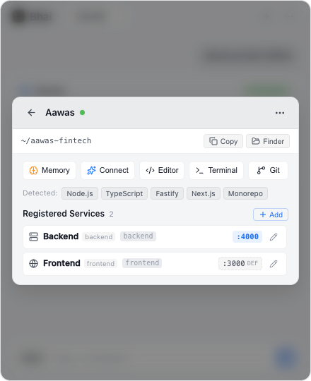
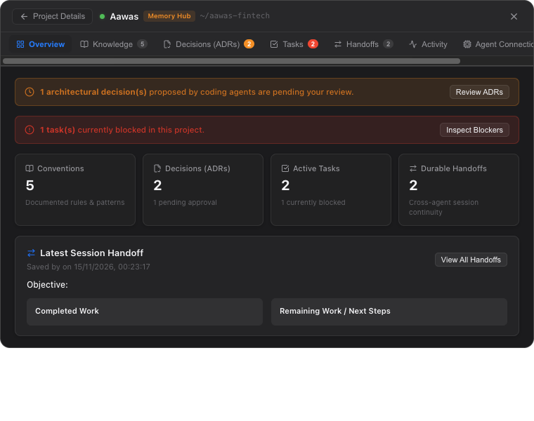
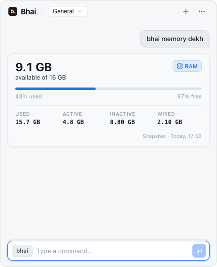
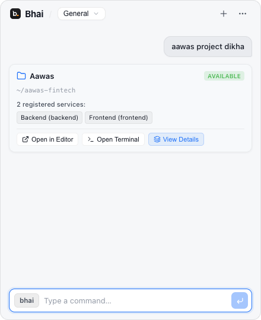
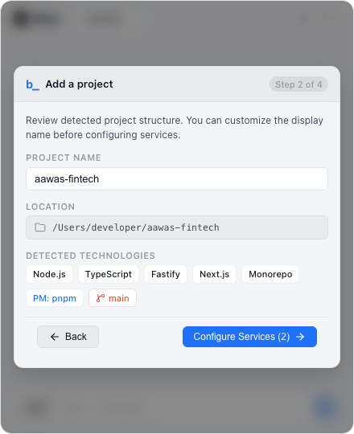
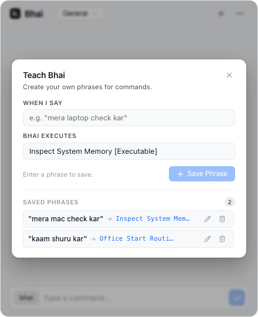

# bh-ai

**Your Mac. Your projects. Your context.**

bh-ai is an open-source macOS assistant that gives your coding agents a shared,
local memory of your projects. It remembers decisions, tracks work, and preserves
handoffs so the next session can pick up with useful context.

Its assistant, **Bhai**, lives in your menu bar. Ask in English or Hinglish,
inspect your Mac's memory, open a registered project, or review what your agents
have been working on. Core assistance and project memory run locally without an
LLM, cloud account, or external AI API.

**Early-stage · macOS 14+ · Apple Silicon · MIT licensed**

[Website (hi-bhai.vercel.app)](https://hi-bhai.vercel.app/) · [Get started](#get-started) · [Connect your agents](#connect-your-agents) ·
[Current scope](#what-works-today) · [Contribute](CONTRIBUTING.md)

## Why bh-ai exists

A repository tells an agent what the code looks like. It often leaves out why a
decision was made, which approach already failed, what is blocked, and where the
last session stopped. That context gets scattered across chats, editors, and
people.

bh-ai gives it a home alongside your local projects. An agent can record meaningful
progress, propose a decision for review, and leave a structured handoff. Another
connected agent can retrieve that context when work resumes.

The goal is to spend less time re-explaining a project and make each session's
useful discoveries available to the next one.

## A workflow it supports

Imagine you're working on an API across several sessions:

1. **Register the repository.** Review its detected technologies and services,
   then connect your coding agents from the project detail view.
2. **Start with context.** A connected agent requests a context pack containing
   relevant project knowledge, decisions, task progress, and the latest handoff.
3. **Leave useful milestones.** During the work, the agent records discoveries,
   test evidence, and blockers through bh-ai's local MCP tools.
4. **Review what becomes durable.** Use the Memory Hub to inspect knowledge and
   review proposed architectural decisions.
5. **Continue in another session.** For example, Claude Code can save a handoff
   that Codex retrieves before continuing the same project.

Memory grows from what you and connected agents record. The bundled
[memory skill](skills/bhai-project-memory/SKILL.md) guides agents to retrieve
context at the start, save meaningful milestones, and prepare handoffs.

## See it in action

UI captures from the running application, showcasing both light and dark macOS native interfaces.

### 1. Memory Hub & Project Continuity

The Memory Hub organizes durable project knowledge, architectural decisions, task progress, active blockers, and session handoffs into one unified command center.

| Memory Hub · Light Mode | Memory Hub · Dark Mode |
| --- | --- |
|  |  |

### 2. Assistant & Project Details

Ask Bhai in English or Hinglish directly from your menu bar (`⌘ + Shift + Space`), inspect your hardware, register projects, and view detected services.

| Assistant (Menu Bar) · Light Mode | Project Details · Light Mode |
| --- | --- |
|  |  |

### 3. Decisions & Agent Integration

Review agent-proposed decisions and manage MCP connections for Cursor, Claude Code, Codex, and Antigravity.

| Architectural Decision Records (ADRs) | Connected Coding Agents (MCP) |
| --- | --- |
|  |  |

### 4. Interactive Project Onboarding & Custom Aliases

Register repositories with automated technology detection, or teach Bhai custom natural language phrases.

| Project Onboarding & Tech Detection | Teachable Custom Aliases |
| --- | --- |
|  |  |

Screenshots use demo data and show both dark and light themes.

## What works today

| Area | Available capabilities |
| --- | --- |
| **Mac assistant** | Menu-bar panel, global shortcut, persistent chats, and RAM inspection |
| **English and Hinglish commands** | Supported command patterns, typo tolerance, clarification, negation handling, and teachable aliases |
| **Project awareness** | Guided registration, technology and service detection, Git inspection, and editor, Terminal, and Finder actions |
| **Project memory** | Knowledge, conventions, tasks, blockers, decisions, checkpoints, and durable handoffs |
| **Agent continuity** | Local MCP integration for Codex, Claude Code, Cursor, and Google Antigravity |
| **Context retrieval** | Searchable memory, deterministic compaction, and context packs with configurable token budgets |

bh-ai is currently distributed as source. Build it locally using the instructions
below; a packaged installer is not included.

### Where it's headed

The product has three pillars: **Assistant**, **Memory**, and **Workflows**. The
current implementation covers the assistant foundation, project registry, and
memory engine. Visual workflow creation, managed service start/stop, and broader
system actions are planned. Some commands can be recognized before their actions
are available; the app reports that limitation.

The [feature specification](BHAI_MVP_FEATURES.md) describes the broader vision.
The [roadmap](docs/planning/IMPLEMENTATION_ROADMAP.md) and implementation reports
track the development phases.

## Get started

### Requirements

- An **Apple Silicon Mac running macOS 14+**. The native helper currently builds
  for `arm64-apple-macos14.0`.
- **Node.js 24 and npm**, recommended. The package requires Node.js 22.12 or later;
  `.nvmrc` selects version 24.
- **Xcode Command Line Tools**, including Swift. Install them with
  `xcode-select --install` if needed.

Clone or download this repository, open a terminal in its directory, and run:

```bash
npm ci
npm run build
npm run rebuild:electron
npm start
```

The build compiles the app and native Swift helper. The rebuild step prepares
native dependencies for Electron.

### Your first few minutes

1. Open Bhai from the menu bar or press **Command + Shift + Space**. If the shortcut
   is unavailable, the app attempts **Option + Space**.
2. Try `bhai memory dekh` to inspect RAM usage.
3. Enter `project add karo` or choose **+ Add Project**, select a repository, and
   review the detected metadata before saving.
4. Open the project details to inspect services and Git status, launch local tools,
   or enter the **Memory** hub.

## Connect your agents

bh-ai exposes project memory through **Model Context Protocol (MCP)**, allowing
different coding agents to use the same local store.

1. Keep Bhai running and open a registered project's detail view.
2. Choose **Connect** to install project-specific MCP configuration and memory
   guidance for Codex, Claude Code, Cursor, and Google Antigravity.
3. Reload the agent's MCP connection or restart its editor to load the configuration.
4. Ask the agent to retrieve the project's bh-ai context before starting work.

The connection flow writes agent configuration in the relevant user directories
and skill/rule files in the project. The separate global agent setup installs
guidance; connecting a project supplies its MCP configuration.

The desktop UI, `bhai` command prefix, and existing integration names such as
`bin/bhai-mcp` and `bhai-project-memory` use the assistant's name, Bhai.

<details>
<summary>Available MCP tools</summary>

| Tool | What an agent uses it for |
| --- | --- |
| `yebata` | Fetch a project context pack |
| `kaamkaha` | Check task progress and blockers |
| `kahanthe` | Retrieve the latest handoff |
| `servicesbata` | Inspect registered project services |
| `kyabadla` | Retrieve memory changes since an earlier point |
| `dhoondh` | Search project memory |
| `yesavekar` | Record a meaningful progress checkpoint |
| `yaadrakh` | Propose durable knowledge or a decision for review |
| `handoffsavekar` | Save a structured session handoff |

Context packs have quick, task, and deep modes. Their default estimated token
budgets are 550, 1,600, and 4,000 respectively.

See the [memory skill](skills/bhai-project-memory/SKILL.md),
[agent integration design](docs/architecture/P4_AGENT_INTEGRATION.md), and
[MCP design](docs/architecture/P4_MCP_DESIGN.md) for the contracts and workflow.

</details>

## Your data and trust boundaries

Chats and project memory live in a local SQLite database, `bhai.sqlite`, under
Electron's application user-data directory. The app does not encrypt that database.

Agent access uses project-scoped, revocable token authorization over a local Unix
domain socket. Agents must run on the same Mac to connect directly; remote editor
hosts and containers require additional bridging. Keep the desktop app running
while agents use its tools.

Memory records distinguish **observed facts**, **agent-reported claims**,
**user-approved knowledge**, and **historical information**. This lets you inspect
where information came from and review proposed decisions. Retrieved context
still needs checking against the current code and environment.

Connected coding agents may send retrieved context to their own model providers,
depending on their settings. Review those settings before granting access to
private projects. See [SECURITY.md](SECURITY.md) for reporting and security boundaries.

## How it fits together

The app uses **Electron, React, TypeScript, SQLite, and Swift**.

```text
Menu-bar UI → validated IPC → utility process → SQLite project memory
                                    ↑
Coding agent → stdio MCP bridge → local socket broker
```

The renderer handles interaction, the main process owns desktop integration and
the MCP broker, and the utility process handles inspection, execution, and database
writes. The memory engine performs deterministic compaction without requiring a model.

## Develop and contribute

Documentation improvements, reproducible bug reports, command-language coverage,
and focused code contributions are welcome. For larger changes, open an issue to
discuss the approach first. Follow [CONTRIBUTING.md](CONTRIBUTING.md) and the
[community guidelines](CODE_OF_CONDUCT.md).

Build before testing because the runners load compiled files from `dist/`:

```bash
npm run build
npm run typecheck
npm test
```

The default suite covers command handling, storage, project registration, memory,
compaction, MCP transport, and cross-agent handoffs. Phase-specific runners are
available as `npm run test:p1` through `npm run test:p4`; `test:p1` also includes
Electron verification. GitHub CI builds and runs the default suite on macOS.

If Node-based tests report a `better-sqlite3` ABI mismatch, run
`npm rebuild better-sqlite3` and retry. Before launching the app afterward, run
`npm run rebuild:electron` to restore the Electron native module.

<details>
<summary>Repository map and technical documentation</summary>

```text
src/main/       Desktop lifecycle, IPC, and MCP broker
src/renderer/   React interface and styles
src/preload/    Typed renderer bridge
src/utility/    Execution, inspection, SQLite storage, and memory
src/language/   Offline command understanding
src/mcp/        Stdio MCP bridge
src/native/     Swift macOS helper
src/shared/     Contracts and shared types
src/tests/      Unit, integration, and Electron tests
scripts/        Test runners, capture tools, and benchmarks
skills/         Coding-agent memory guidance
docs/           Architecture, planning, design, and reports
```

- [Technical design](docs/architecture/TECHNICAL_DESIGN.md)
- [Security design](docs/architecture/SECURITY_DESIGN.md)
- [Memory engine](docs/architecture/P4_MEMORY_ENGINE.md)
- [Context compaction](docs/architecture/P4_CONTEXT_COMPACTION.md)
- [Testing strategy](docs/planning/TESTING_STRATEGY.md)
- [Benchmark report](docs/benchmarks/P4_BENCHMARK_REPORT.md)

</details>

## License

bh-ai is available under the [MIT License](LICENSE). Third-party dependencies
retain their respective licenses. The npm package is marked `private` to prevent
accidental registry publication.
