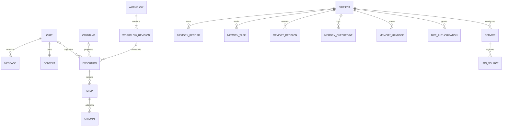

# Local data model and recovery

Status: conditionally approved core; staged schema and trust refinements proposed, product acceptance pending. SQLite is canonical persistence, with a single connection owned by the engine utility process subject to signed P0 compatibility. No Postgres/server, ORM requirement, renderer database access, or localStorage business data. UUIDs are generated locally; timestamps are UTC with explicit timezone formatting in UI. Timestamps are not ordering or authorization primitives.

## Storage layout and transaction rules

Under Electron's `app.getPath('userData')`: `bhai.sqlite`, its SQLite-managed WAL/SHM files, `backups/`, and bounded `logs/`. Main passes the canonical data directory on engine startup. Configuration JSON export goes only to a user-selected destination. Restrict directories to the current user (0700) and files (0600 where practical); fail visibly on unsafe permissions or unavailable storage. Do not put the active database on a network filesystem.

Enable foreign keys, WAL and `synchronous=FULL` for the first implementation; use short transactions and a bounded busy timeout. Benchmark before relaxing durability. Single-writer engine simplifies consistency, but WAL still requires correct checkpoint/backup handling. SQLite documents WAL constraints and sidecar files. [SQLite WAL](https://www.sqlite.org/wal.html).

Persist an attempt intent before external effects; transactional atomicity covers database rows, not OS state. Transactions also cover: chat+first message creation; command/message/sequence allocation; alias+index revision changes; workflow revision save; step result+event commit; chat deletion coordination. Never keep an SQL transaction open while awaiting permission, filesystem/network IO, or a subprocess.

## Entity catalogue

Types: `ID` = UUID text; `TS` = UTC timestamp; booleans constrained to 0/1; enums checked; JSON validated at application boundaries with schema/version fields. Use integer monotonic revisions for optimistic concurrency. Store bounded JSON only for typed documents; index searchable relational columns.

| Entity | Essential fields | Constraints / relationships |
|---|---|---|
| `schema_migrations` | version PK, checksum, appliedAt | Forward-only reviewed migrations; checksum mismatch blocks startup |
| `chats` | id PK, title, createdAt, updatedAt, revision, nextCommandSeq, state | state active/deleting; title ≤128 chars |
| `messages` | id PK, chatId FK, chatSeq, role, kind, sanitizedBody, commandId nullable, executionId nullable, createdAt | Unique `(chatId, chatSeq)`; stable cursor pagination; cascade on chat delete; body ≤64 KiB |
| `chat_contexts` | chatId PK/FK, schemaVersion, revision, lastCommandSeq, projectId/serviceId/appId nullable, sourceMessageId nullable, observationRefs JSON | Only same chat references; delete with chat; invalid resources cleared or marked stale |
| `commands` | id PK, chatId FK nullable, commandSeq, originSessionId, requestId, originalText, resolutionStatus, proposalSnapshot JSON, resolverVersion, createdAt | Deduplicate `(originSessionId, requestId)`; raw command text bounded; deletion removes text |
| `clarification_drafts` | id PK, chatId FK, commandId, candidates JSON, configRevision, expiresAt, status | At most one pending/chat; never cross-chat; deleted with chat |
| `projects` | id PK, displayName, rootGrantId, canonicalRoot, volume/file identity nullable, detectedMetadata JSON, revision, availability, createdAt | Folder identity uniqueness where reliable; duplicate names allowed with clarification |
| `services` | id PK, projectId FK, name, relativeCwd, startRecipeId/testRecipeId/stopRecipeId nullable, port nullable, readiness JSON, revision | Unique service ID/project; port 1–65535; no assumption port uniqueness system-wide |
| `service_dependencies` | serviceId FK, dependsOnServiceId FK | Composite PK; same project; acyclic checked in validator |
| `applications` | id PK, bundleId, displayName, selectedBundlePath nullable, revision, capabilities JSON | Known/user-selected bundles; no raw app-path trust from renderer |
| `path_grants` | id PK, canonicalRoot, purpose, fileIdentity nullable, grantedAt, revokedAt nullable, revision | Read/write/launch purposes explicit; persisted user intent does not bypass OS permission |
| `command_recipes` | id PK, projectId nullable, mode exec/shell, executable identity, argv JSON or literal script, cwdGrant/subpath, envSpec JSON, fingerprint, revision | No renderer/chat interpolation; sensitive fields encrypted or secret refs |
| `log_sources` | id PK, projectId/serviceId nullable, kind, grant/subpath or managedProcessId, encoding, enabled, revision | File and managed-stream initial kinds; outside-root sources separately granted |
| `workflow_definitions` | id PK, name, enabled, currentRevision, origin, deletedAt nullable | Stable identity; deletion soft-disables new runs |
| `workflow_revisions` | workflowId FK, revision, schemaVersion, document JSON, hash, createdAt | Composite PK; immutable; old revisions referenced by runs retained until retention expires |
| `aliases` | id PK, phrase, normalizedPhrase, targetKind, targetId, bindings JSON, enabled, revision | Indexed multi-map; collisions explicit, not overwritten; polymorphic references validated transactionally |
| `preferences` | key PK, schemaVersion, value JSON, revision | Hotkey, launch at login, appearance, log retention, approved connectivity destination; validated allowlist |
| `executions` | id PK, workflowId nullable, definitionRevision nullable, snapshot JSON, originChatId FK nullable, commandId FK nullable, state, planHash, engineEpoch, createdAt, endedAt nullable, summary JSON | Snapshot sufficient if definition later edited/deleted; terminal state immutable |
| `execution_steps` | executionId FK, stepId, ordinal, state, resolvedParams JSON, output JSON, error JSON, startedAt/endedAt | Composite PK; bounded sanitized outputs |
| `step_attempts` | id PK, executionId/stepId FK, attemptNo, intentAt, launchAt nullable, finishedAt nullable, outcome, evidenceRefs JSON | Unique step+attemptNo; crash-gap outcome unknown |
| `execution_events` | executionId FK, seq, kind, stepId nullable, summary JSON, createdAt | Composite PK; state/progress history; transient high-rate output not stored as events |
| `managed_processes` | id PK, serviceId nullable, recipeSnapshotHash, launchAttemptId, pid, pgid, startIdentity, bootIdentity, engineEpoch, cwdIdentity, state, exitCode nullable | PID alone never a key/authority; process rows may outlive initiating chat (P5) |
| `observations` | id PK, executionId FK nullable, chatId FK nullable, sourceId nullable, kind, observedAt, expiresAt, coverage, redactedEvidence JSON, byteCount | Evidence bounded, purpose-limited and subject to retention |
| `recipe_approvals` | id PK, recipeId, recipeFingerprint, meaningfulResourceFingerprints JSON, policyVersion, grantedAt, revokedAt nullable | Config-level trust over semantic executable/argv/script/cwd/env/scope; cosmetic revisions do not revoke it; never grants arbitrary related commands |
| `secret_blobs` | id PK, encryptedBytes, purpose, createdAt | Only explicitly needed recipe env secrets; decrypted just in time through main safeStorage broker |
| `memory_records` | id PK, projectId FK, category, title, content, tier, confidence, authorType, authorId, revision, isActive, createdAt, updatedAt | Project-scoped architectural facts/conventions; strict 4-tier separation; bounded content (<=16 KB); ON DELETE RESTRICT |
| `memory_tasks` | id PK, projectId FK, title, description, status, assignedAgent, priority, blockersSummary, completionEvidence, createdAt, updatedAt | Project task tracking across agents; active vs completed; ON DELETE RESTRICT |
| `memory_decisions` | id PK, projectId FK, title, status, context, decision, consequences, authorType, authorId, userApprovalStatus, createdAt, updatedAt | Architectural Decision Records (ADRs); permanent retention; ON DELETE RESTRICT |
| `memory_checkpoints` | id PK, projectId FK, taskId FK nullable, sessionId, clientName, checkpointType, summary, payloadJson, idempotencyKey, clientSequence, evidenceRefsJson, tier, createdAt | Milestone-driven agent event journal; bounded <=2 KB; unique (proj, client, sess, key); ON DELETE RESTRICT |
| `memory_handoffs` | id PK, projectId FK, taskId FK nullable, sessionId, authorClient, objective, completedSummary, remainingSummary, blockersSummary, decisionsSummary, relevantFilesJson, testStatusSummary, knownUncertainties, createdAt | Cross-agent session handoff packages; durable retention by default; ON DELETE RESTRICT |
| `mcp_authorizations` | id PK, clientName, projectId FK, tokenHash, scopes, isRevoked, createdAt, lastUsedAt | Project-scoped local MCP client access grants and revocations; ON DELETE RESTRICT |
| `context_cache` | (projectId, packMode) PK, contentHash, contextText, estimatedTokens, cachedAt, expiresAt | Materialized token-budgeted Context Packs; invalidated on revision changes; ON DELETE RESTRICT |
| `memory_fts` | virtual table fts5(entity_id, project_id, entity_type, title, content) | SQLite FTS5 index for fast BM25 keyword search across project memory |

Run-specific confirmation tickets remain memory-only in main, never exported or restored after restart. Persist only a minimal approval audit outcome (action/plan hash/time), not a reusable token. Global aliases cover project/app/service/action/workflow naming; no separate competing alias arrays are authoritative.

## Staged physical schema and avoidable complexity

The catalogue above is an eventual logical model, not an instruction to create every table/repository in P1. Use plain forward migrations grouped by the behavior being delivered; avoid unused tables, generic entity stores, ORM layers or event-sourcing/replay infrastructure.

| Phase | Minimum schema addition | Deliberate staging limit |
|---|---|---|
| P1 secure slice | Migrations (001), chats/messages/context/commands, executions/steps/attempts/state events and required preferences | Store the single metric's bounded result in step output; add observations earlier only if stable evidence references are needed. No project/workflow configuration repositories yet |
| P2 language/context | Aliases and clarification drafts (002) | References to test catalog identities are validated; no classifier/training database |
| P3 projects | Path grants, projects, services (003) | Safe unregistration, service metadata editing; no command execution before recipe policy |
| P4 project memory | Memory records, tasks, decisions, checkpoints, handoffs, MCP auth, context cache (004), FTS5 index (005), and memory lifecycle RESTRICT / safe archival (006) | Project-isolated persistent memory; safe archival/re-registration; ON DELETE RESTRICT; durable handoff retention; strict 4-tier separation; 0 LLM dependency for Layer A; indestructible decisions/blockers |
| P5 managed runtime | Service dependencies, managed process identity, and process supervision records | Existing ledger extends rather than creating a second scheduler DB; state events record transitions |
| P6 saved workflows | Definitions and immutable definition revisions | Steps remain typed JSON in immutable definitions plus relational execution steps; no duplicate graph schema |
| P7 context automation | Secret blobs/safeStorage integration, environment drift tables, retention fields | If secret env values are needed before P7, implement protected storage then; never use temporary plaintext persistence |

Transactions/FKs/revisions, chat scoping, project isolation, intent-before-effect, short bounded writes and migration backups are required from the first relevant phase. Full active-chat deletion/snapshot scrubbing must arrive before exposing deletion while work can run; until implemented, explicitly block that operation with a reason. Adding schema later cannot be used to weaken isolation or lose committed safety state.

## Relationships and indexes

Indexes: messages `(chatId, chatSeq)`; commands `(chatId, commandSeq)` plus request dedupe; executions `(originChatId, createdAt, id)` and `(state, createdAt)`; events `(executionId, seq)`; aliases `(normalizedPhrase, enabled, targetKind)`; services `(projectId, name)`; projects canonical root; observations `(expiresAt)`; log sources `(serviceId, enabled)`; process records `(serviceId, state)`. No FTS transcript search or vector index is needed. Exact maps and Fuse index are derived caches with configuration revision tags; reconstruct from DB after recovery.

SQL cannot enforce every polymorphic target relation. Save/delete repositories must validate aliases and workflow reference integrity in the same transaction; periodic checks occur at startup migration/repair, not constant background scans. Repository queries require chat ID arguments; no “most recent message” query without chat scope is allowed for resolution.

## Chat context lifecycle and concurrency

Creating a chat inserts empty context; opening it loads its own messages/context only. Renaming is revision checked. Returning to it restores identity references, not stale operational observations. Global saved config is searchable without copying other chat context. A foreground `activeChatId` preference is UI navigation only, never a resolver target source.

Each command gets a monotonic sequence within its chat. Interpretation runs serially per chat. Explicit target updates use compare-and-swap on context revision and sequence. A run captures a context snapshot at submission; completion may append its result but cannot overwrite a newer target selection. A `logs dikha` in Chat B remains unresolved even while Chat A's Aawas workflow completes. Resource edits invalidate references on use; deletion clears incompatible project/service focus and prompts for a new target.

Entity context may persist indefinitely until invalidated or explicitly cleared. Observation reuse expires after 60 s, clarification drafts after 10 min, and confirmations after 2 min. These separate lifetimes prevent persisted identity from being mistaken for fresh process/health evidence. Restart discards approval authority and rechecks all resource identities.

## Chat deletion during execution

Proposed default: show active runs/owned services and offer **cancel associated active runs then delete**, or return. Do not silently stop completed-run services, which are global service resources; enumerate them as still running with a separate stop option. This policy needs product review in [OPEN_DECISIONS.md](../planning/OPEN_DECISIONS.md).

Mark chat deleting transactionally, reject new submissions/clarifications/context writes, revoke its pending confirmations, and cancel queued/running executions. Wait for bounded cancellation; if effects cannot stop, show explicit uncertainty and require a choice to retain chat or continue deletion with remaining work visible globally. Never hang deletion forever and never imply cancellation rolled back prior effects.

If user chooses deletion despite remaining work, atomically remove messages/context/drafts/command text, null run origin chat/command references, and scrub chat text/context from run snapshots and evidence. Keep only minimum action/target/ownership data needed to finish/cancel safely. Result subscribers verify the chat still exists; they cannot recreate it. Remaining runs are visible in global execution history with “originating chat deleted”. On terminal transition purge detached chat-specific diagnostic content. Global projects/workflows/aliases/preferences remain.

Foreign keys: chat messages/context/drafts cascade; executions and process history use nullable origin links; command text rows cascade or are scrubbed; global definitions do not cascade from a chat. Application-level deletion transaction performs snapshot scrubbing that FKs cannot. Safety/process records may survive briefly as operational data, never as conversational memory for another chat.

## Migrations, crash recovery, and backups

Check schema version before any writes; a newer unsupported DB opens recovery UI, not automatic downgrade. Before a migration, create a consistent SQLite backup using the backup API, retain three bounded migration backups, and verify space. Migrate transactionally where SQLite supports it, update checksum/version only on success, then validate foreign keys and representative reads. Failure preserves original/backup and disables executions. No destructive repair without an explicit reviewed recovery action.

Unclean engine restart performs SQLite recovery and a bounded quick check; deeper integrity check is on-demand if problems arise. Mark nonterminal runs interrupted and drop old engine lock ownership. Rebuild indexes only after successful migration/reconciliation. Never copy only `bhai.sqlite` while ignoring a live WAL; never delete WAL to “repair” data. Restore via staged DB verification and atomic replacement when engine is closed; preserve the broken DB for explicit recovery rather than erasing it.

Storage is not fully encrypted by default: SQLite/chats/configuration remain readable to the same OS user or backup administrators. FileVault and restricted local permissions provide at-rest environmental protection; app-level secrets use safeStorage. SQLCipher is not silently assumed. Full database encryption is an open decision with packaging/search/recovery cost, not a completed property.

## Export/import

Versioned JSON configuration envelope contains export schema version, app/catalog compatibility, projects with user-approved path placeholders, services, recipe definitions with secret refs removed, workflow definitions, aliases and portable preferences. Exclude chats/context/messages, execution/log history, approvals, secret blobs, decrypted environment values, recent diagnostics, machine IDs, absolute home paths unless explicitly opted in, and login/hotkey OS grant claims.

Preview shows sensitive/custom script content before export; literal scripts may themselves contain secrets, so redact known values and ask user to inspect before including them. Default export omits literal secret-bearing recipe fields and marks setup incomplete. Secret detection cannot guarantee confidentiality for arbitrary script text; default omit custom shell bodies unless explicitly selected. Imported templates can refer to a missing recipe and remain disabled pending reconfiguration.

Import reads ≤5 MiB, enforces depth/count/string limits, rejects unknown versions/actions and dangerous prototype keys, validates references, presents conflict mapping, then commits transactionally. IDs remap on collision; never silently replace existing trusted recipes. Root grants must be selected/reconfirmed locally; executable approvals reset, recipes/workflows remain disabled until reviewed, and secrets must be re-entered. Imported appearance may apply after preview; startup/hotkey preferences need local capability checks. No imported data executes during parse or preview.

## Retention and explicit deletion

Proposed defaults: chats retained until deleted; diagnostic evidence 7 days; execution summaries/step states 30 days or 1,000 terminal runs, whichever limit is reached first; sanitized subprocess files 3 days subject to 50 MiB global cap. Users can choose shorter/zero diagnostic persistence and clear history. Active runs/owned process identity survive history pruning until no longer operationally required. Raw logs are never stored before redaction.

Prune at startup and after relevant user operations in small chunks; no proactive health scheduler. Cap event counts per run (2,000 persisted state events), paginate message/history reads, and surface storage-limit warnings. History limits must not silently truncate still-active safety state. Configuration exports omit history independently of retention.

Delete-chat/history controls explain that local backups may contain older content. App-managed backups holding deleted chat data are invalidated/deleted in the deletion flow; restore preview warns about old data. “Delete all local data” requires explicit confirmation, stops/reconciles owned work, clears DB/WAL/backups/logs/secret blobs and resets preferences with engine closed. Filesystem unlink/VACUUM cannot guarantee forensic erasure on APFS snapshots, external backups or SSDs; UI says “remove Bhai's local data”, not secure wipe. External user-selected exports are user-managed and are listed as outside app deletion control.
