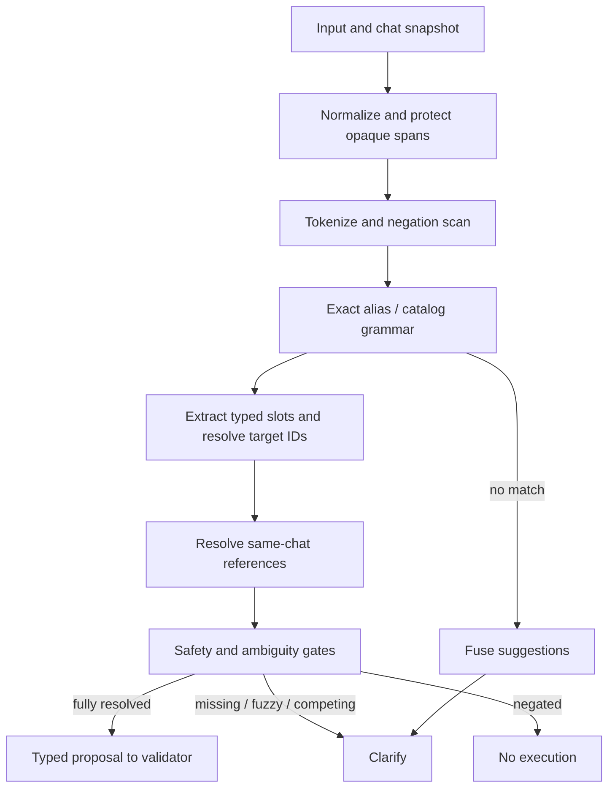

# Offline language engine

Status: conditionally approved core; real-phrase acceptance protocol proposed, product acceptance pending. Implements F02/F07 and same-chat references from F01. This is a finite command grammar over a known action catalog, not unrestricted conversation. Existing examples are authored specification/regression seeds, **not a collected real-developer corpus or measured accuracy**. All resolution is local; no classifier training, model download, remote inference, or mandatory AI.

## Library evaluation and choice

| Candidate | Useful primitives | Fit and limitations | Decision |
|---|---|---|---|
| Fuse.js | Weighted typo-tolerant lookup of saved labels/aliases | Good fallback candidate ranking; does not understand intent, Hinglish negation, or permissions. Scores are distances, not probabilities | Use behind `CandidateSearch`, after exact lookup |
| Compromise | Tokenization, English normalization/matching/entity utilities, custom lexicons | English-centric; full POS/NER bundle unnecessary for short domain commands; cannot assume Hinglish support | Use `compromise/tokenize` behind `Tokenizer`; preserve original spans/opaque tokens; benchmark before adopting heavier exports |
| Natural | Tokenizers, edit distances, classifiers, stemming | Mature broad toolbox; package manifest includes substantial unrelated dependencies; statistical classification needs representative training and conflicts with explicitly non-AI MVP | Evaluated, omit from runtime |
| wink-nlp | Fast token/NER/POS pipeline with separate language model | Offline, but model/bundle and English assumptions add cost; not needed for finite action slots; not an out-of-box Hinglish parser | Omit; model-backed classification not part of this MVP |
| NLP.js | Intent classification/entity tooling, multilingual facilities | Trained intent models and broad bot framework exceed deterministic non-AI scope; romanized code-switching still needs data | Omit |
| Native `Intl.Segmenter` / Unicode regex | Token boundary fallback | No external package, but does not provide domain matching; simple opaque slot recognizers still needed | Fallback if tokenizer changes protected tokens |

Fuse provides local fuzzy search without dependencies. [Fuse documentation](https://www.fusejs.io/). Compromise publishes a tokenizer subpath and separate typed module exports; its observed branch requires Node ≥18. [Compromise manifest](https://raw.githubusercontent.com/spencermountain/compromise/master/package.json). Natural's breadth and dependency surface are visible in its manifest. [Natural manifest](https://github.com/NaturalNode/natural/blob/master/package.json). wink requires an additional language model; NLP.js includes trained intent facilities. [wink documentation](https://winkjs.org/wink-nlp.html), [NLP.js repository](https://github.com/axa-group/nlp.js).

The custom work is the small domain grammar, Hinglish synonym tables, safety policy, and context resolver. It reuses existing tokenization/fuzzy primitives and does not reimplement a general NLP engine. No cited library establishes reliable Hinglish command accuracy; that requires Bhai's own held-out corpus.

## Contracts and pipeline

Input: `{chatId, commandId, sequence, text, configRevision, chatContextSnapshot}`. Output is a discriminated union:

- `resolved`: proposal ID, ordered typed action proposals, original/normalized spans, target IDs/revisions, evidence route, safety classification.
- `clarify`: bounded candidate IDs and labels or missing-slot question, pending draft ID, expiry and chat ID.
- `negated`: explanation, prohibited spans, no executable plan.
- `unsupported`: supported suggestions, optional Teach entry point, no execution.
- `invalid`: input/range/grammar error, no partial execution.

No output contains an executable string derived from free text. Parameters refer to saved resources or bounded typed values. Main/engine policy still validates every resolved proposal.

### 1. Normalize without erasing meaning

Keep the original text for display and span mapping. Reject NUL/control injection, excessive length (>2,048 characters), and malformed inputs. Use Unicode normalization (NFKC) for comparison only; preserve originals for resource display. Collapse whitespace and case-fold command vocabulary. Remove `bhai` only as a leading standalone address token, never within an entity.

Protect quoted labels, exact saved multiword names/aliases, numeric literals, and path-like text before lexical transformations. Do not lowercase filesystem paths, strip shell metacharacters into a new valid command, remove all punctuation, or erase negation stopwords. File actions accept registered paths; arbitrary typed paths prompt selection rather than grant access. Reject unsupported scripts/transliteration with supported examples; MVP Hinglish means curated Roman-script variants. Devanagari support is an open product decision, not assumed.

Synonym data maps whole tokens/phrases with semantic categories: `kholo/khol/open/launch`, `dikha/dekh/show`, `chala/chalao/start`, `band/stop/close` only in action-specific grammar, `ram/memory`, `awaaz/volume`. Never map `band` unconditionally to process kill or `nahi` to nothing. Prefix punctuation and repeated letters are not globally corrected; common variants must be explicit or go to suggestions.

### 2. Negation and compound command policy

Recognize `mat`, `nahi`, `nahin`, `na` in curated imperative patterns and English `don't/do not/never/not`. Scan before alias or fuzzy acceptance and after clause splitting. Negative imperatives veto the complete submitted chain; MVP does not execute a positive fragment of a mixed negative instruction. Double negation, uncertain scope, and rhetorical/conditional phrasing ask for rephrasing.

Distinguish a whitelisted negative diagnostic query (`backend kyu nahi chal raha`, `why is backend not running`) from a prohibited instruction (`backend mat chala`). Diagnostic grammar is read-only and requires a named/unambiguous contextual service. An exact registered name containing `not` is protected as an entity only with unambiguous boundaries; uncertain text asks for clarification. Teaching aliases containing negation does not bypass this gate: reserve unsafe trigger forms and reject them in the alias editor.

Limited chaining supports at most three actions separated by `aur/and/then` **between complete recognized clauses**, outside quoted/known names. Never split `Research and Development` if it is a known label. Parse and validate all clauses before any execution. `then` and other supported conjunctions mean ordered execution, not parallel work. Any unknown/ambiguous/negated clause blocks the chain. Scope carryover between clauses is limited to an explicit target in the immediately preceding clause, recorded in the draft; validate it exactly like a same-chat reference. Stop later steps after an execution failure; no implicit rollback.

### 3. Intent and entity resolution

Priority is governed by evidence, not a single best string score:

1. Exact catalog phrases and exact taught aliases produce candidates. Collisions across action/project/workflow namespaces remain ambiguous; user aliases cannot shadow reserved dangerous vocabulary or override safety.
2. Curated token patterns identify intent and slot roles. Project/service/app names are resolved by longest exact registered label span. Examples: `[project] [service] logs dikha`; `port [integer] check`; `volume [0..100]`; `[project] test`.
3. Match full grammar; unexplained action-bearing tokens (`force`, `delete`, `except`, `unless`) invalidate rather than get discarded. Optional politeness words are explicit, bounded grammar elements.
4. If exact lookup fails, retrieve at most five Fuse candidates from the relevant namespace. Do not fuzzy-correct numeric values, file paths, URLs, negative words, action permission classes, or script bodies.

Numeric slots: integer port 1–65535; volume 0–100 (percent); positive duration with explicit supported units (`ms`, `seconds/sec/s`, `minutes/min/m`) and an action-specific cap (readiness ≤120 s, finite command timeout ≤10 min). `50` without a parameter role or `3000 or 3001` asks for clarification. No natural date/time scheduling. Tool names resolve to saved executable recipes and never raw executable paths from chat.

Application names map to a small known bundle-ID registry plus explicitly user-selected apps. Discover known app existence on request, not a full disk scan. `code` shared by a project and VS Code is ambiguous unless syntax uniquely establishes namespace. Service names without a project may use the current chat's relevant project only if that service exists uniquely there.

## Confidence policy

Use an explainable **resolution evidence tier**, not a claim of statistical confidence:

| Tier | Evidence | Behavior |
|---|---|---|
| E1 | Exact supported alias/grammar, one valid explicit target, no conflict or negation | Proceed to independent permission policy |
| E2 | Exact grammar, valid same-chat stable target, no competing current focus | Proceed; display inherited target in result/confirmation |
| E3 | Fuzzy target/phrase, missing required slot, conflicting namespaces, stale context | Clarify; no action |
| E4 | Unknown grammar, uncertain negation, unsupported compound/parameter | Explain or rephrase; no action |

Initial Fuse retrieval policy: request scores, threshold 0.30, normalized candidate span ≥4 characters, top candidate score ≤0.20 and runner-up margin ≥0.10 may receive “likely match” presentation. Lower distance is better. These are **tuning defaults, not execution thresholds**; no fuzzy candidate auto-executes, even for read-only probes. A user selection resolves exact target identity for that draft, then validation/policy reruns. With fewer than two candidates, still require selection if the match was fuzzy. Very short aliases are exact-only. Confirmations are mandatory for risk classes regardless of evidence tier.

Do not compare scores across different libraries or treat `1 - FuseScore` as a probability. Log resolver route and timing locally without retaining unnecessary raw input. Calibrate suggestions with held-out data; changing fuzzy thresholds cannot weaken negation, ambiguity or approval gates.

## Per-chat context

Canonical context is a small persisted row per chat: version, last accepted command sequence, selected project/service/app IDs, originating message/command references, recent execution reference, revision, and explicit invalidation markers. No transcript search across chats and no shared “last project”. Global index availability is configuration, not memory.

- Explicit user targets replace focus only after a fully accepted, validated command or clarified selection. An unsupported or negated command never changes context.
- Entity identity may persist across app restarts/long absences. On use, check existence, configuration revision and resource accessibility; persistently saved identity is not persistent evidence of running state.
- Metric/log observations expire after 60 s for reuse; process IDs never become a durable conversational target. Refresh status on demand.
- A project focus has at most one service focus. Changing project clears incompatible service; deleting a service/project marks references invalid. `logs dikha` with project focus but multiple possible sources/services clarifies unless a single unambiguous default is configured.
- `stop it` requires a unique still-valid service/app focus and normal risk confirmation. Do not infer a target from a previous chat, global last run, stale PID, or whatever currently listens on a port.
- Serialize interpretation/context commits per chat. Background executions may overlap; completion updates use sequence compare-and-swap and cannot overwrite focus set by a later command.

Clarification state is stored under the initiating chat/draft, expires after 10 minutes, and captures configuration revisions. Selection by candidate ID is preferred to interpreting bare `yes`. Only one active clarification draft per chat; new unrelated commands supersede it. Switching chats does not migrate it. Restart restores the draft for display but requires a fresh plan/permission evaluation before execution. A selected candidate that was edited/deleted is invalidated.

## Teach Bhai

Unsupported input offers supported catalog suggestions and “attach phrase” to a selected action or workflow. Save an alias with normalized phrase, original display phrase, target kind/ID, optional typed fixed bindings, version, and enabled state. Preview collisions across project/app/action/workflow namespaces before save. Conflicting aliases may be saved only with explicit warning and remain non-executable without disambiguation; reserved unsafe forms are rejected.

Teaching never executes the target or creates an approval. No dynamic regex, parameter substitution scripts, executable interpolation, or generated shell command. Bound aliases to 128 characters and 10,000 total entries for benchmarked operation. Editing or deleting aliases atomically rebuilds affected index entries. References to deleted workflows become disabled with an explanatory label.

## Optional future adapter boundary

A `CommandPlanner` consumes text, an explicitly scoped current-chat context snapshot and approved catalog metadata, and returns the same proposal/clarification union. MVP registers only `DeterministicPlanner`. A later optional AI planner may propose versioned workflow definitions for review/save. It cannot register actions, execute directly, grant file access, mint approvals, change confidence gates, read other chats, or supply arbitrary scripts. No AI SDKs, keys, prompts, or provider UI are included now.

## Validation gates

See [TESTING_STRATEGY.md](../planning/TESTING_STRATEGY.md) for a seed corpus, expansion protocol and metrics. Essential invariants: no side effects from resolver calls, no cross-chat fallback, no execution for negated/ambiguous/fuzzy-only inputs, no alias approval bypass, no partial chain execution at parse time, and no target substitution after confirmation.

Acceptance must separately measure independently collected developer utterances and the synthetic/adversarial safety suite. Collect actual English/Romanized Hinglish task phrasing before showing canonical examples; retain provenance, consent, intended action/target and ambiguity labels. Split by participant/task family and keep an untouched release set; tune phrase tables and Fuse only on development data. Report intent accuracy, target accuracy, joint correctness, Hinglish slices, safe rejection, justified versus unnecessary clarification and p50/p95 matching latency. A larger synthetic corpus or zero-action “clarify everything” policy cannot satisfy P2. Recruitment/collection is pending; no real-use accuracy claim exists in this revision. UI clarification/Teach follows the [UX specification](../design/UX_SPECIFICATION.md#clarification-and-guided-teach-bhai).
