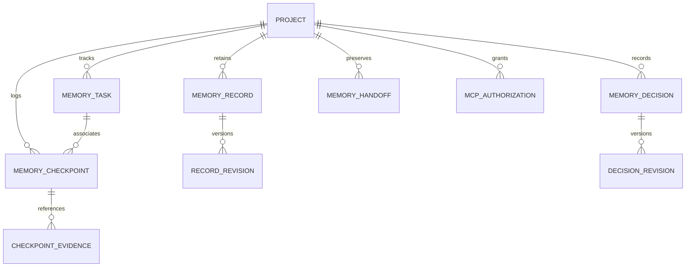

# Bhai — Phase P4 Architecture: Memory & Context Engine

**Document ID:** P4-ARCH-001  
**Phase:** P4 — Project Memory & Context Engine  
**Status:** Architectural Design  
**Target Platform:** macOS 14+ (Sonoma, Sequoia), Apple Silicon (`arm64`)  

---

## 1. Subsystem Architecture Overview

The **Bhai Memory Engine** provides structured, durable, offline project knowledge for both the Bhai Assistant and external coding agents. It lives entirely within Bhai's Node-enabled **Utility Process**, preserving the strict **single-writer SQLite model**.

```
+-------------------------------------------------------------------------------+
|                                Electron Main                                  |
|  - Lifecycle, Tray, Global Hotkey                                             |
|  - Native Directory Picker, Capability Authorization                         |
|  - IPC Broker (MessagePort to Utility Process)                                |
+------------------------------------+------------------------------------------+
                                     |
                                     | MessagePort (Private IPC)
                                     v
+-------------------------------------------------------------------------------+
|                       Electron Utility Process (Engine)                       |
|                                                                               |
|  +--------------------+   +----------------------+   +---------------------+  |
|  | Checkpoint Pipeline|   |  Compaction Reducer  |   | Context Pack Engine |  |
|  | - Auth & Grants    |   | - Layer A (Deterministic)| - Relevance Ranking |  |
|  | - Idempotency      |   | - Layer B (Local LLM)|   | - Token Budgeting   |  |
|  | - Secret Redaction |   | - Invariant Validator|   | - FTS5 Search Index |  |
|  +---------+----------+   +----------+-----------+   +----------+----------+  |
|            |                         |                          |             |
|            +-------------------------+--------------------------+             |
|                                      |                                        |
|                                      v                                        |
|                   +------------------------------------+                      |
|                   |       MemoryRepository (TS)        |                      |
|                   +------------------+-----------------+                      |
|                                      |                                        |
|                                      v                                        |
|                   +------------------------------------+                      |
|                   |      SQLite Database (WAL Mode)    |                      |
|                   | - memory_records, memory_tasks     |                      |
|                   | - memory_decisions, checkpoints    |                      |
|                   | - memory_handoffs, context_cache   |                      |
|                   | - memory_fts (FTS5 Virtual Table)  |                      |
|                   +------------------------------------+                      |
+-------------------------------------------------------------------------------+
                                     ^
                                     | Unix Domain Socket / IPC
                                     |
+------------------------------------+------------------------------------------+
|                       Local MCP Stdio Bridge                                  |
|  - Spawned by agent (Claude Code, Codex, Cursor)                              |
|  - stdio <---> JSON-RPC MCP Server                                            |
|  - Client Token & Project Grant Verification                                 |
+-------------------------------------------------------------------------------+
```

---

## 2. Memory Domain Model & Entity Relationships

The memory model is strictly project-scoped, referencing the primary project identifier (`projects.id` established in Phase P3).



### 2.1 Core Entities & Lifecycle Semantics

#### Unregistration vs Permanent Purge
- **Safe Archival (Default):** Unregistering a project (`projectRepo.deleteProject(projectId)`) marks the project as `unregistered` and sets `archived_at = Date.now()`. Active services and chat contexts are cleared, but all memory records, ADRs, tasks, checkpoints, and handoffs remain durably preserved in SQLite. Re-registering the project at the same `canonicalRoot` reactivates the project ID and re-links all historical memory.
- **Referential Integrity (`ON DELETE RESTRICT`):** Migration 006 establishes `ON DELETE RESTRICT` on all memory tables. Raw accidental SQL deletion of a project row is blocked by SQLite.
- **Explicit Permanent Purge:** Calling `deleteProject(projectId, { permanent: true })` explicitly invokes `memoryRepo.purgeProjectMemory(projectId)`, clearing memory entities, grants, and the project row.

#### 1. `memory_records` (Architectural Knowledge & Conventions)
Represents durable facts, architectural constraints, project conventions, and key directory pointers.
- `id` (TEXT, PK): `mem_rec_<uuid>`
- `project_id` (TEXT, FK -> `projects.id` ON DELETE RESTRICT)
- `category` (TEXT): `overview`, `architecture`, `convention`, `directory_pointer`, `constraint`
- `title` (TEXT): Bounded title (<= 128 chars)
- `content` (TEXT): Structured Markdown content (<= 16 KB)
- `tier` (TEXT): `observed_fact`, `agent_claim`, `user_approved`, `historical`
- `confidence` (TEXT): `verified`, `unverified`, `approved`, `disputed`
- `author_type` (TEXT): `user`, `bhai_inspector`, `agent`
- `author_id` (TEXT): Identifier of user, inspector rule, or agent client name
- `revision` (INTEGER): Monotonic revision number (starts at 1)
- `is_active` (INTEGER): `1` for active, `0` for tombstoned/superseded
- `created_at` (INTEGER): UTC epoch milliseconds
- `updated_at` (INTEGER): UTC epoch milliseconds

#### 2. `memory_tasks` (Active & Completed Work Units)
Tracks tasks across sessions and agents to prevent work duplication.
- `id` (TEXT, PK): `mem_tsk_<uuid>`
- `project_id` (TEXT, FK -> `projects.id` ON DELETE CASCADE)
- `title` (TEXT): Short summary of task (<= 256 chars)
- `description` (TEXT): Detailed objectives and criteria (<= 4 KB)
- `status` (TEXT): `backlog`, `in_progress`, `blocked`, `completed`, `abandoned`
- `assigned_agent` (TEXT): e.g. `claude-code:session_123`
- `priority` (INTEGER): 1 (high) to 3 (low)
- `blockers_summary` (TEXT, Nullable): Short description of current impediment
- `completion_evidence` (TEXT, Nullable): Summary of test results or commit hash
- `created_at` (INTEGER): UTC epoch milliseconds
- `updated_at` (INTEGER): UTC epoch milliseconds

#### 3. `memory_decisions` (Architectural Decision Records - ADRs)
Permanent records of accepted, rejected, or deprecated architectural and engineering decisions.
- `id` (TEXT, PK): `mem_dec_<uuid>`
- `project_id` (TEXT, FK -> `projects.id` ON DELETE CASCADE)
- `title` (TEXT): Decision title (<= 256 chars)
- `status` (TEXT): `proposed`, `accepted`, `rejected`, `deprecated`
- `context` (TEXT): Problem statement and driving factors
- `decision` (TEXT): The selected approach
- `consequences` (TEXT): Positive, negative, and neutral trade-offs
- `author_type` (TEXT): `user` or `agent`
- `author_id` (TEXT): Client or user identity
- `user_approval_status` (TEXT): `pending`, `approved`, `rejected`
- `created_at` (INTEGER): UTC epoch milliseconds
- `updated_at` (INTEGER): UTC epoch milliseconds

#### 4. `memory_checkpoints` (Event Journal)
Granular, milestone-driven progress checkpoints submitted by agents.
- `id` (TEXT, PK): `mem_chk_<uuid>`
- `project_id` (TEXT, FK -> `projects.id` ON DELETE CASCADE)
- `task_id` (TEXT, FK -> `memory_tasks.id` ON DELETE SET NULL, Nullable)
- `session_id` (TEXT): Agent session identifier
- `client_name` (TEXT): e.g. `claude-code`, `codex`, `cursor`
- `checkpoint_type` (TEXT): `task.started`, `task.progress`, `decision.proposed`, `discovery.recorded`, `files.modified`, `evidence.recorded`, `blocker.discovered`, `blocker.resolved`, `assumption.invalidated`, `task.completed`, `handoff.prepared`
- `summary` (TEXT): Concise single-line summary (<= 256 chars)
- `payload_json` (TEXT): Structured payload (bounded <= 2 KB)
- `idempotency_key` (TEXT): Client-supplied unique token
- `client_sequence` (INTEGER): Monotonic sequence counter from client
- `evidence_refs_json` (TEXT, Nullable): JSON array of file/git/test references
- `tier` (TEXT): `agent_claim` or `observed_fact`
- `created_at` (INTEGER): UTC epoch milliseconds

#### 5. `memory_handoffs` (Cross-Agent Continuation Documents)
Structured handoff packages prepared by departing agents for subsequent sessions. Preserved durably in SQLite without automatic pruning; retrieval pagination is decoupled from retention.
- `id` (TEXT, PK): `mem_hnd_<uuid>`
- `project_id` (TEXT, FK -> `projects.id` ON DELETE RESTRICT)
- `task_id` (TEXT, FK -> `memory_tasks.id` ON DELETE SET NULL, Nullable)
- `session_id` (TEXT): Producing agent session UUID
- `author_client` (TEXT): Producing client name
- `objective` (TEXT): Target goal of the session
- `completed_summary` (TEXT): Bullet points of verified work completed
- `remaining_summary` (TEXT): Clear next steps for the incoming agent
- `blockers_summary` (TEXT, Nullable): Unresolved obstacles
- `decisions_summary` (TEXT, Nullable): Key decisions made during session
- `relevant_files_json` (TEXT): JSON array of touched file paths and roles
- `test_status_summary` (TEXT, Nullable): Test results and command evidence
- `known_uncertainties` (TEXT, Nullable): Caveats and assumptions requiring check
- `created_at` (INTEGER): UTC epoch milliseconds

#### 6. `mcp_authorizations` (Local Client Security Grants)
Project-scoped access tokens for local MCP clients.
- `id` (TEXT, PK): `mcp_auth_<uuid>`
- `client_name` (TEXT): Client identifier (e.g. `claude-code`)
- `project_id` (TEXT, FK -> `projects.id` ON DELETE RESTRICT)
- `token_hash` (TEXT): SHA-256 hash of provisioned secret grant token
- `scopes` (TEXT): Comma-separated permissions: `read_memory`, `write_checkpoints`, `propose_decisions`
- `is_revoked` (INTEGER): 0 for active, 1 for revoked
- `created_at` (INTEGER): UTC epoch milliseconds
- `last_used_at` (INTEGER, Nullable): UTC epoch milliseconds

#### 7. `context_cache` (Prebaked Context Pack Cache)
Materialized context pack representations for rapid retrieval.
- `project_id` (TEXT, PK, FK -> `projects.id` ON DELETE RESTRICT)
- `pack_mode` (TEXT, PK): `quick`, `task`, `deep`
- `content_hash` (TEXT): SHA-256 hash of dependent memory revisions
- `context_text` (TEXT): Formatted markdown content pack
- `estimated_tokens` (INTEGER): Token count estimate
- `cached_at` (INTEGER): UTC epoch milliseconds
- `expires_at` (INTEGER): UTC epoch milliseconds

---

## 3. SQLite Schema & Migration Plan

### 3.1 Migration 004: Core Memory Schema (`004_p4_memory_foundation`)
```sql
-- Migration version: 4
-- Name: 004_p4_memory_foundation

CREATE TABLE IF NOT EXISTS memory_records (
  id TEXT PRIMARY KEY,
  project_id TEXT NOT NULL,
  category TEXT NOT NULL,
  title TEXT NOT NULL,
  content TEXT NOT NULL,
  tier TEXT NOT NULL DEFAULT 'agent_claim',
  confidence TEXT NOT NULL DEFAULT 'unverified',
  author_type TEXT NOT NULL,
  author_id TEXT NOT NULL,
  revision INTEGER NOT NULL DEFAULT 1,
  is_active INTEGER NOT NULL DEFAULT 1,
  created_at INTEGER NOT NULL,
  updated_at INTEGER NOT NULL,
  FOREIGN KEY (project_id) REFERENCES projects(id) ON DELETE CASCADE
);

CREATE INDEX IF NOT EXISTS idx_memory_records_project ON memory_records(project_id, is_active, category);

CREATE TABLE IF NOT EXISTS memory_tasks (
  id TEXT PRIMARY KEY,
  project_id TEXT NOT NULL,
  title TEXT NOT NULL,
  description TEXT NOT NULL,
  status TEXT NOT NULL DEFAULT 'backlog',
  assigned_agent TEXT,
  priority INTEGER NOT NULL DEFAULT 2,
  blockers_summary TEXT,
  completion_evidence TEXT,
  created_at INTEGER NOT NULL,
  updated_at INTEGER NOT NULL,
  FOREIGN KEY (project_id) REFERENCES projects(id) ON DELETE CASCADE
);

CREATE INDEX IF NOT EXISTS idx_memory_tasks_project ON memory_tasks(project_id, status);

CREATE TABLE IF NOT EXISTS memory_decisions (
  id TEXT PRIMARY KEY,
  project_id TEXT NOT NULL,
  title TEXT NOT NULL,
  status TEXT NOT NULL DEFAULT 'proposed',
  context TEXT NOT NULL,
  decision TEXT NOT NULL,
  consequences TEXT NOT NULL,
  author_type TEXT NOT NULL,
  author_id TEXT NOT NULL,
  user_approval_status TEXT NOT NULL DEFAULT 'pending',
  created_at INTEGER NOT NULL,
  updated_at INTEGER NOT NULL,
  FOREIGN KEY (project_id) REFERENCES projects(id) ON DELETE CASCADE
);

CREATE INDEX IF NOT EXISTS idx_memory_decisions_project ON memory_decisions(project_id, status);

CREATE TABLE IF NOT EXISTS memory_checkpoints (
  id TEXT PRIMARY KEY,
  project_id TEXT NOT NULL,
  task_id TEXT,
  session_id TEXT NOT NULL,
  client_name TEXT NOT NULL,
  checkpoint_type TEXT NOT NULL,
  summary TEXT NOT NULL,
  payload_json TEXT NOT NULL,
  idempotency_key TEXT NOT NULL,
  client_sequence INTEGER,
  evidence_refs_json TEXT,
  tier TEXT NOT NULL DEFAULT 'agent_claim',
  created_at INTEGER NOT NULL,
  FOREIGN KEY (project_id) REFERENCES projects(id) ON DELETE CASCADE,
  FOREIGN KEY (task_id) REFERENCES memory_tasks(id) ON DELETE SET NULL,
  UNIQUE (project_id, client_name, session_id, idempotency_key)
);

CREATE INDEX IF NOT EXISTS idx_checkpoints_project_created ON memory_checkpoints(project_id, created_at DESC);
CREATE INDEX IF NOT EXISTS idx_checkpoints_task ON memory_checkpoints(task_id, created_at DESC);

CREATE TABLE IF NOT EXISTS memory_handoffs (
  id TEXT PRIMARY KEY,
  project_id TEXT NOT NULL,
  task_id TEXT,
  session_id TEXT NOT NULL,
  author_client TEXT NOT NULL,
  objective TEXT NOT NULL,
  completed_summary TEXT NOT NULL,
  remaining_summary TEXT NOT NULL,
  blockers_summary TEXT,
  decisions_summary TEXT,
  relevant_files_json TEXT NOT NULL DEFAULT '[]',
  test_status_summary TEXT,
  known_uncertainties TEXT,
  created_at INTEGER NOT NULL,
  FOREIGN KEY (project_id) REFERENCES projects(id) ON DELETE CASCADE,
  FOREIGN KEY (task_id) REFERENCES memory_tasks(id) ON DELETE SET NULL
);

CREATE INDEX IF NOT EXISTS idx_handoffs_project ON memory_handoffs(project_id, created_at DESC);

CREATE TABLE IF NOT EXISTS mcp_authorizations (
  id TEXT PRIMARY KEY,
  client_name TEXT NOT NULL,
  project_id TEXT NOT NULL,
  token_hash TEXT NOT NULL,
  scopes TEXT NOT NULL,
  is_revoked INTEGER NOT NULL DEFAULT 0,
  created_at INTEGER NOT NULL,
  last_used_at INTEGER,
  FOREIGN KEY (project_id) REFERENCES projects(id) ON DELETE CASCADE,
  UNIQUE (client_name, project_id)
);

CREATE TABLE IF NOT EXISTS context_cache (
  project_id TEXT NOT NULL,
  pack_mode TEXT NOT NULL,
  content_hash TEXT NOT NULL,
  context_text TEXT NOT NULL,
  estimated_tokens INTEGER NOT NULL,
  cached_at INTEGER NOT NULL,
  expires_at INTEGER NOT NULL,
  PRIMARY KEY (project_id, pack_mode),
  FOREIGN KEY (project_id) REFERENCES projects(id) ON DELETE CASCADE
);
```

### 3.2 Migration 005: Full-Text Search Virtual Tables (`005_p4_fts5_indexing`)
```sql
-- Migration version: 5
-- Name: 005_p4_fts5_indexing

-- SQLite FTS5 index for fast, token-efficient keyword search across project memory
CREATE VIRTUAL TABLE IF NOT EXISTS memory_fts USING fts5(
  entity_id UNINDEXED,
  project_id UNINDEXED,
  entity_type UNINDEXED,
  title,
  content,
  tokenize = 'porter unicode61'
);

-- Triggers to maintain FTS5 synchronization automatically
CREATE TRIGGER IF NOT EXISTS trg_memory_records_ai AFTER INSERT ON memory_records BEGIN
  INSERT INTO memory_fts(entity_id, project_id, entity_type, title, content)
  VALUES (new.id, new.project_id, 'record', new.title, new.content);
END;

CREATE TRIGGER IF NOT EXISTS trg_memory_records_ad AFTER DELETE ON memory_records BEGIN
  DELETE FROM memory_fts WHERE entity_id = old.id;
END;

CREATE TRIGGER IF NOT EXISTS trg_memory_records_au AFTER UPDATE ON memory_records BEGIN
  DELETE FROM memory_fts WHERE entity_id = old.id;
  INSERT INTO memory_fts(entity_id, project_id, entity_type, title, content)
  VALUES (new.id, new.project_id, 'record', new.title, new.content);
END;

CREATE TRIGGER IF NOT EXISTS trg_memory_decisions_ai AFTER INSERT ON memory_decisions BEGIN
  INSERT INTO memory_fts(entity_id, project_id, entity_type, title, content)
  VALUES (new.id, new.project_id, 'decision', new.title, new.decision || ' ' || new.context);
END;

CREATE TRIGGER IF NOT EXISTS trg_memory_decisions_ad AFTER DELETE ON memory_decisions BEGIN
  DELETE FROM memory_fts WHERE entity_id = old.id;
END;

CREATE TRIGGER IF NOT EXISTS trg_memory_decisions_au AFTER UPDATE ON memory_decisions BEGIN
  DELETE FROM memory_fts WHERE entity_id = old.id;
  INSERT INTO memory_fts(entity_id, project_id, entity_type, title, content)
  VALUES (new.id, new.project_id, 'decision', new.title, new.decision || ' ' || new.context);
END;
```

---

## 4. Continuous Checkpoint Ingestion Pipeline

The ingestion pipeline processes agent milestone updates safely, continuously, and transactionally, guided by the canonical `bhai-project-memory` skill (see [P4_AGENT_INTEGRATION.md](P4_AGENT_INTEGRATION.md)):

```
[Agent Tool Call: yesavekar (recordCheckpoint)]
                |
                v
[Local Stdio Adapter: Validates JSON-RPC & Checks Auth Token]
                |
                v
[Bhai IPC Broker: Frame & Rate-Limit Check (Max 60/min)]
                |
                v
[Utility Process: CheckpointIngestionHandler]
  ├── 1. Schema Validation (Zod: <=2 KiB payloadJson, required fields)
  ├── 2. Secret Redactor (Strip bearer tokens, PEMs, AWS keys, private keys)
  ├── 3. Idempotency Check: SELECT FROM memory_checkpoints WHERE (proj, client, sess, key)
  │        └── Match found: Return existing ID immediately (No-op)
  ├── 4. Optimistic Concurrency Check: If baseRevision provided, verify not superseded
  ├── 5. Transactional Write (Immediate Transaction):
  │        ├── INSERT INTO memory_checkpoints (tier='agent_claim')
  │        ├── If task.status changed -> UPDATE memory_tasks
  │        ├── If blocker reported/resolved -> UPDATE memory_tasks blockers array
  │        ├── If decision proposed -> INSERT INTO memory_decisions (status='proposed', tier='agent_claim')
  │        └── Invalidate affected project in context_cache
  └── 6. Return success DTO to agent with assigned sequence
```

### 4.1 Ingestion Invariants
1. **Crash Isolation:** If the utility process terminates midway, SQLite's atomic transaction automatically rolls back. Zero half-written checkpoints can exist.
2. **Backpressure:** A single agent session cannot submit more than 200 checkpoints. Checkpoints 201+ are rejected with `SESSION_CHECKPOINT_QUOTA_EXCEEDED` unless compacted.
3. **Sensitive Data Neutralization:** Raw logs or file contents submitted in `payloadJson` are scanned by `SecretRedactor` (reusing the tested P1/P3 pattern) before disk write.
4. **Epistemic Integrity:** Agent-submitted checkpoints and proposed decisions are **always** persisted with tier `agent_claim`. They are **never** silently promoted to `observed_fact` or `user_approved` without user confirmation in the Memory UI.

---

## 5. Storage Policies, Quotas & Retention

| Data Entity | Maximum Quota / Size | Retention Policy | Purge Behavior |
| :--- | :--- | :--- | :--- |
| **Checkpoints** | Max 2 KiB per payloadJson; 200 per session | 30 days default; older transient events compacted | Logical compaction merges progress events; raw events pruned |
| **Tasks** | Max 4 KB description | Active tasks: indefinite. Completed tasks: 90 days | Completed tasks compacted into project changelog summaries |
| **Decisions (ADRs)**| Max 16 KB per decision | **Indefinite (Never automatically deleted)** | User-controlled deprecation only |
| **Handoffs** | Max 16 KB per handoff document | Last 10 handoffs per project retained | Older handoffs archived to summary records |
| **Context Cache** | Max 32 KB per pack | TTL: 24 hours or until invalidated | Dropped on memory write or TTL expiry |

---

## 6. Failure Recovery & Error States

1. **Missing or Corrupt Database:** Bhai's existing startup diagnostics trigger standard transactional recovery and PRAGMA integrity checks.
2. **Concurrent Agent Writes:** SQLite's WAL mode and 5,000 ms busy timeout serialize concurrent agent writes safely in the Utility Process.
3. **Stale Context References:** When a project is moved or unregistered in Bhai, `FOREIGN KEY ... ON DELETE CASCADE` automatically and atomically cleans up all associated memory records, checkpoints, and cached context packs. Source code directories remain 100% untouched.
