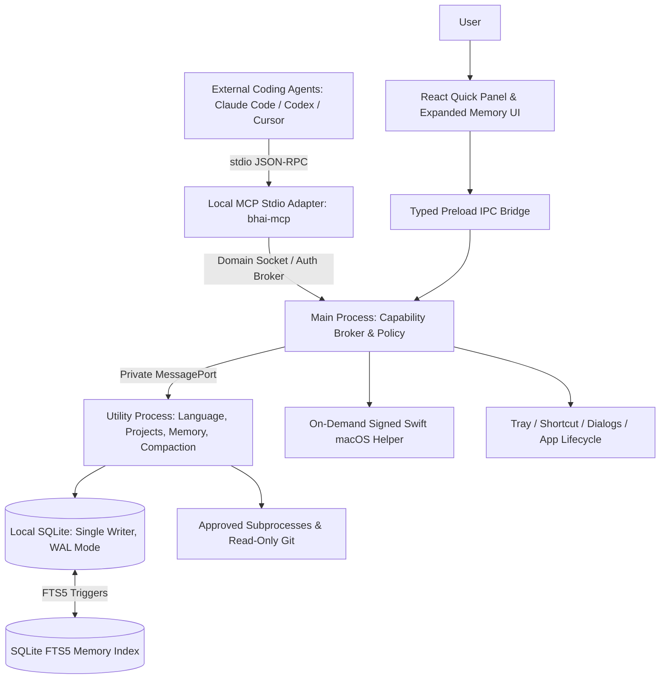

# Bhai technical design

Design/review revision: 2026-11-14. **Status: conditionally approved core architecture; required revisions proposed, product-owner acceptance pending.** This document set plans implementation and P0 experiments; it does not authorize application/harness implementation, installation or P1. No compatibility experiment has run.

## Authority and reading order

[BHAI_MVP_FEATURES.md](../../BHAI_MVP_FEATURES.md), version 1.0, is the scope authority and was read in full. Defaults below are proposed technical behavior, not additions to the feature inventory. Read this overview, then [components](COMPONENT_ARCHITECTURE.md), [language](LANGUAGE_ENGINE.md), [workflows](WORKFLOW_ENGINE.md), [data](DATA_MODEL.md), [security](SECURITY_DESIGN.md), and [technology decisions](TECHNOLOGY_DECISIONS.md). Execution guidance lives in the [roadmap](../planning/IMPLEMENTATION_ROADMAP.md), [tests](../planning/TESTING_STRATEGY.md), and [open decisions](../planning/OPEN_DECISIONS.md).

The review adds [UX_SPECIFICATION.md](../design/UX_SPECIFICATION.md) and [ARCHITECTURE_REVIEW_ACTIONS.md](../planning/ARCHITECTURE_REVIEW_ACTIONS.md). The latter is authoritative for P0 experiment procedures/evidence/fallbacks and P1 entry approval. Existing module documents remain authoritative for their contracts; this is one architecture, not competing proposals.

## Architecture decision

Use a modular desktop application with three primary trust boundaries: a sandboxed React renderer, a small Electron main process that brokers privileged capabilities, and one Node-enabled Electron utility process for domain services and database ownership. In Phase P4, Bhai integrates external AI coding agents (Claude Code, Codex, Cursor) via a local Model Context Protocol (MCP) stdio bridge connected to the main capability broker. The utility process remains the **sole owner of SQLite**, managing chats, projects, workflows, diagnostic observations, and the **P4 Project Memory Engine** (including checkpoint ingestion, deterministic compaction, and token-budgeted Context Packs).

Native helper candidate: a small signed Swift executable, invoked on demand by main only for fixed AppKit app identity/status/graceful quit and CoreAudio volume gaps demonstrated by P0 E03. Its purpose is access to public macOS APIs, not elevation. It does not accept scripts or run persistently.

Every natural command yields a typed proposal. The executor validates it independently, checks resource identity and approvals, then runs registry actions. In Phase P4, AI coding agents communicate with Bhai through typed MCP tools (`yebata`, `yesavekar`, `handoffsavekar`, etc.), which are validated by the capability broker and executed transactionally in SQLite by the Utility Process.

## Feature coverage and dependencies

| Scope | Components | Prerequisites | Acceptance evidence |
|---|---|---|---|
| F01 tray, hotkey, persistent chat create/rename/switch/revisit/delete | Desktop shell, chat repository, context resolver, run subscription | Secure IPC, schema migrations | Restart persistence; A/B context isolation; hidden panel leaves run alive |
| F02 offline English/Hinglish, aliases, parameters, follow-ups, limited chaining | Language pipeline, exact indexes, Fuse, tokenizer, clarification state | Action schemas, project/app registry, chat context | Gold corpus; zero unsafe execution on negative set |
| F03 app/folder/system/network/volume assistance | App registry, native helper, diagnostics adapters | Capability broker, process runner, permissions UX | Real signed-Mac tests with missing/denied capability outcomes |
| F04 guided project awareness and multi-service operations | Metadata detector, registry, service config, process supervisor | File grants, typed commands, action registry | No metadata scripts executed; indexed lookup; partial setup useful |
| P4-F01 Persistent Project Memory | Memory repository, entity models, schema migrations 004/005, FTS5 | F04 project registry, SQLite WAL | Survives cold restart; strict 4-tier separation; project isolated |
| P4-F02 Continuous Checkpoints | Ingestion pipeline, secret redactor, idempotency ledger | P4-F01, MCP broker | <=2 KB bounded payloads; max 200/session; duplicate retries idempotent |
| P4-F03 Offline Hybrid Compaction | Deterministic AST reducer (Layer A), optional local LLM (Layer B) | P4-F01, P4-F02 | 0 LLM dependency; decisions & blockers never lost; contradictions explicit |
| P4-F04 Prebaked Context Packs | Pack builder, token counter, cache invalidator | P4-F01, P4-F03 | Quick ~500, Task ~1,500, Deep ~4,000 tokens; stale references tagged |
| P4-F05 Local MCP Context Bridge | Stdio MCP adapter, broker auth, typed tool schemas | P4-F01, P4-F04, local socket IPC | Claude Code / Codex connect; token authentication; project grants |
| P4-F06 Memory Management UI | Expanded window UI, ADR editor, client revocations | P4-F01, P4-F05 | Visual curation; 8 discoverable views; 1-click client revocation |
| P4-F07 Cross-Agent Handoffs | Handoff state machine, continuation schemas | P4-F02, P4-F04, P4-F05 | Claude Code -> Codex seamless continuation; unverified claims flagged |
| P4-F08 Security & Permissions | Token store, secret redactor, untrusted prompt delimiters | P4-F05, P4-F06 | 100% offline; prompt injection mitigations; secret minimization |
| P4-F09 Context Benchmarking | Benchmark harness, 6 scenario suites, telemetry | P4-F01 through P4-F08 | Reproducible reduction in discovery tool calls and tokens vs baselines |
| F05 developer diagnostics | Diagnostic orchestrator, adapters, redactor, signature rules | F04 resources, bounded runner, observation model | Evidence-backed findings and unknown/permission-denied cases (P5) |
| F06 visual workflows | Versioned definitions, sequential executor, progress UI, template library | Durable run ledger, policy engine, typed actions | Conditions, dependency readiness, timeout, retry/cancel/restart tests (P6) |
| F07 teach aliases | Alias editor, conflict validator, resolver index | F02 + stable action/workflow identities | Global aliases work in new chats; no permission inheritance |
| F08 preferences/local persistence/export/import/delete/retention | SQLite repositories, configuration portability, local preferences | Versioned schemas, export redactor, approval invalidation | Secrets excluded; imported commands disabled until approved |

All seven templates are mapped to registry actions in [WORKFLOW_ENGINE.md](WORKFLOW_ENGINE.md). Exclusions remain excluded: no voice, proactive polling, autonomous repair, broad scheduling, unrestricted chat, desktop recording, cloud sync, cross-chat memory, marketplace, arbitrary inferred scripts, or guaranteed private app logs. Ongoing requested work may use bounded readiness timers; this is not a proactive monitor.

## End-to-end behavior

1. Main receives a sender-validated command with chat ID, request ID, and client revision. Engine transactionally verifies the chat exists, allocates its next command sequence, and appends the user message.
2. Resolver uses a versioned snapshot of only that chat's context plus global saved configuration. It returns resolved, clarify, negated, unsupported, or invalid. No action runs inside the resolver.
3. A resolved proposal captures explicit stable IDs and configuration revisions. All chain segments must pass validation before the first side effect. Unknown targets and unsafe fuzzy matches require clarification.
4. Executor creates an immutable execution snapshot, writes a queued run, evaluates permissions, and requests any risk confirmation through main. Confirmation is bound to the exact plan and targets.
5. Engine records step intent before a side effect, executes it, then commits result and events. The unavoidable crash gap between external action and result commit is reported as uncertain; never promise exactly-once external execution.
6. UI receives small sanitized progress events. Messages and final summaries belong to the initiating chat regardless of the currently visible one. Context updates use sequence/revision checks so older concurrent results cannot replace newer focus.

## Lifecycle and failure policy

Single-instance lock prevents duplicate runners and writers. After `app.whenReady`, create tray and register the chosen shortcut; engine opens/migrates storage and rebuilds in-memory indexes. Show explicit starting/recovery UI until ready. Hide the assistant on dismissal; do not quit on `window-all-closed`. Settings is a separate, lazy renderer. Use an accessory/menu-bar presentation and preserve a discoverable Quit command.

Launch at login is opt-in through Electron login-item APIs; no LaunchAgent or privileged helper. Do not auto-start project services at launch. At normal Quit, present active work and offer cancel-and-quit or return; request graceful termination of Bhai-owned services before exit. Allow a visibly explicit force-quit path after a bounded grace interval. Closing a chat panel is never Quit. OS shutdown, force kill, utility crashes, and power failure may leave child processes; recovery must handle that truthfully.

Renderer crash: recreate the view, query durable state, reattach event subscriptions. Engine crash: main blocks new executions, fails outstanding RPCs as engine unavailable, and performs one guarded restart; mark nonterminal executions interrupted before admitting more work. Repeated crashes enter recovery mode with no automatic workflows. Main crash/app restart: reconcile process records on demand; do not restart commands automatically. A process PID/port alone is insufficient evidence of ownership. See workflow recovery for details.

Storage failure is fail-closed for side effects: no new steps if their intent cannot be committed. Keep tray/recovery view available. Use local backup/restore, not silent empty-database replacement. Native helper failure disables that capability and yields a structured error without crashing the engine.

## Review simplifications and trust defaults

Implement one active workflow with a bounded FIFO initially; diagnostic steps may use up to four bounded probes. Status/cancel/approval and chat navigation remain responsive outside that queue. Persistently running services do not hold an active workflow slot. Queueing concurrent submissions preserves originating-chat isolation without requiring a multi-run scheduler. Raising concurrency is optional future tuning after conflict tests, not required infrastructure for the first release.

The data model is an eventual logical inventory: migrate only the tables needed by each phase, retaining transactions/FKs/revisions, intent-before-effect and safe backup/recovery from the first relevant write. Persist state transitions for history, not a generic event-sourcing replay architecture. Begin crash recovery with interrupted/unknown outcomes and user-requested observations; fresh confirmed stop of a surviving candidate requires proven identity evidence. No automatic process adoption or replay.

Four trust classes are visible in UX: granted read-only inspection; safe reversible effect; previously approved project command; run-specific high risk. Approved unchanged starts/tests in Office Start do not re-prompt every run. Semantic recipe trust ignores cosmetic edits but invalidates meaningful executable/script/cwd/environment/resource changes. Outstanding confirmation tickets remain bound to the exact current plan, independently of reusable recipe trust. Stops/quits/cleanup retain run-specific confirmation. Detailed invalidation and repeated-routine acceptance tests are shared by UX, security and workflow documents.

## Project awareness and diagnostics

Project registration grants a selected root and reads bounded metadata only. All executable configurations require a reviewed command recipe. Project matching uses indexed saved names and aliases, not repeated filesystem discovery. Project operations may report incomplete configuration rather than blocking folder/Git access. Folder moves preserve project UUID after explicit relinking; folder disappearance never implies project deletion.

Diagnostics are user-initiated, finite snapshots. CPU samples, health probes, and log reads expose timestamps, duration, limits, permission coverage, and evidence. Readiness probes stop when the requested workflow ends. Never infer a causal diagnosis solely from CPU, free memory, or a matching log substring. Detailed adapters, source limits, and macOS capability boundaries are in [components](COMPONENT_ARCHITECTURE.md).

## Performance budgets

These are proposed release gates to measure in a signed release build, not achieved claims. Baseline: Apple Silicon Mac with 8 GB RAM, local APFS, 1,000 registered projects/10,000 aliases, 100 chats/10,000 messages; also record Intel results if supported. Report p50/p95, warm/cold separately, sample counts, OS, power mode, and dataset. Exclude child service resources from Bhai memory but report them separately.

| Measurement | Proposed gate | Method |
|---|---|---|
| Common command resolution | p95 <100 ms | Engine receipt to proposal, including context query and matching; no action execution |
| Indexed project lookup | p95 <50 ms | Query to stable candidate IDs, no filesystem IO |
| Warm assistant | p95 <300 ms | Shortcut callback to first painted focused input; retained hidden renderer |
| Cold tray availability | p95 <2 s | OS process start to clickable tray |
| Cold command readiness | p95 <3 s | Start to migrated DB/index and usable command input, normal DB |
| Idle CPU | Average <0.5% of one core over 10 min | Hidden panel, no runs; no recurring diagnostic timers |
| Idle memory | Sum RSS ≤300 MiB target | Main + renderer + utility + Chromium helpers after settle; also record physical footprint |
| Warm panel memory increase | ≤100 MiB target | Open compact view after idle; settings closed |
| Workflow dispatch overhead | p95 <25 ms/step | Excludes permission wait, action duration, readiness timers; includes ledger writes |
| UI during diagnostics | p95 input-to-paint <50 ms | Simultaneous bounded log/process snapshot, no long tasks >100 ms |
| Required remote/AI calls | 0 | Offline smoke tests and connection audit |

If budgets fail, first profile; move expensive parsing to a bounded worker thread inside the utility, reduce retained UI/log buffers, and lazy-load settings. Do not add a worker per request or sacrifice safety to hit timing. SQLite synchronous work is isolated from UI/main but must remain bounded so the utility executor stays responsive. Retention pruning runs at startup or explicit operations in small chunks, not on a frequent timer.

## Highest risks and mitigations

1. **Wrong action from informal language:** exact target evidence, negation veto, ambiguity clarification, held-out Hinglish corpus, and confirmation policies independent of scores.
2. **Process ownership and crash uncertainty:** foreground recipes, tracked session/process-group identity, durable attempts, no blind replay or PID-only kill.
3. **macOS/MDM permission variability:** signed capability spikes, no required FDA/Accessibility, supported/denied/unsupported outcomes and approved fallbacks.
4. **Electron/native dependency packaging:** early signed arm64/x64 packaging gate, supported Electron line, rebuilt native SQLite, exact lockfile, entitlement verification.
5. **Sensitive logs and resource growth:** bounded streaming, redaction before IPC/disk, text-only rendering, explicit retention, honest limits on secret detection.

## Research and skill method

Used the installed find-skills workflow and reviewed installed React performance guidance for rendering/indexing/lazy-load decisions. Checked the skill directory for Electron architecture/security guidance. No skill or dependency was installed because the attached task explicitly forbids installation. Third-party skills are hints, not platform evidence; primary sources are linked in the relevant documents. CLI discovery using `npx --no-install` failed because the shell could not resolve the npm registry; browser-based directory research succeeded. No installation or runtime compatibility test is claimed.

Electron provides a Node-enabled utility-process primitive; choosing one engine process is Bhai's design decision. [Electron utilityProcess](https://www.electronjs.org/docs/latest/api/utility-process). The compatibility and release claims in this set are documentation observations as of the design date, not results of a runtime prototype. Required spikes and unresolved product choices are explicitly tracked.
