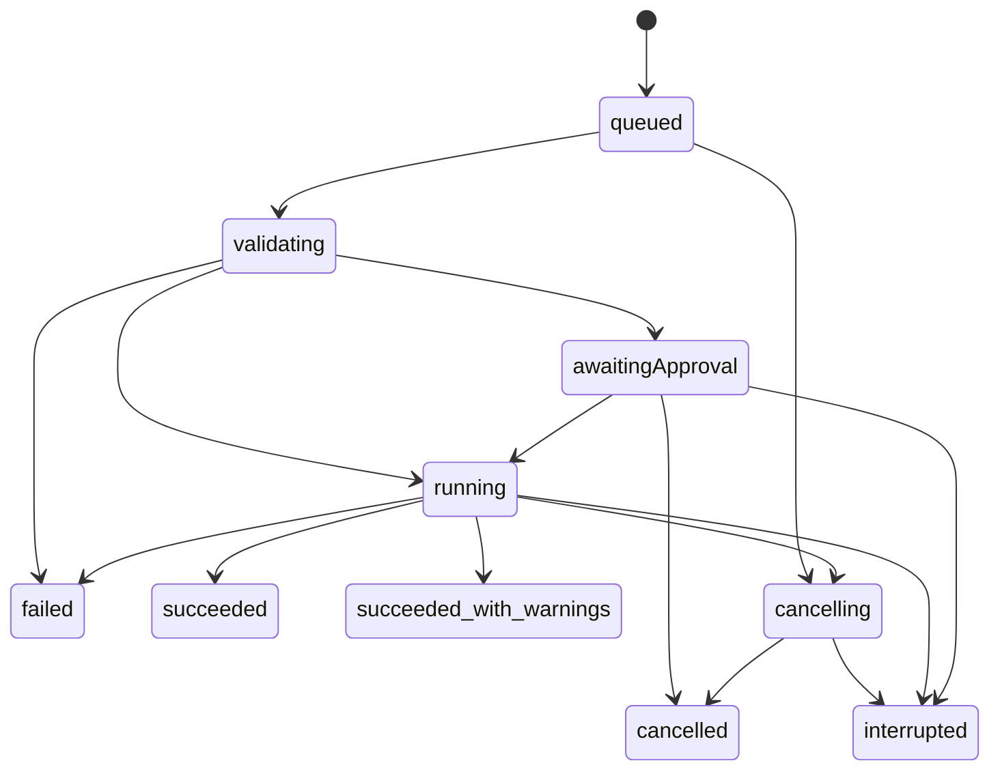

# Declarative workflow engine

Status: conditionally approved core; review refinements proposed, product acceptance pending. Covers F06, direct actions, multi-command chains and the seven templates. In the updated product roadmap, Phase P4 establishes the **Project Memory & Context Engine**, Phase P5 implements **Managed Process Execution**, and Phase P6 implements the **Visual Workflow Studio**. Phase P8 will bridge external coding agents to execute approved Bhai workflows. Uses one static catalog, one schema, one validator and one executor. No hosted workflow system, code interpreter, cron, loops, expression language, arbitrary DAG scheduler, or plugin marketplace. See [UX](../design/UX_SPECIFICATION.md) for the first-release vertical-list builder and four trust classes, and [P0 E05](../planning/ARCHITECTURE_REVIEW_ACTIONS.md#e05--foreground-supervision-cancellation-and-crash-recovery) for unexecuted lifecycle experiments.

## Definition schema

Version 1 is JSON data, strictly validated with Zod and serializable as JSON Schema for tooling. A builder form and a future planner produce the same representation. “Dependencies” mean service prerequisites and explicit references to **earlier** workflow steps; execution remains sequential.

| Field | Type / constraints |
|---|---|
| `schemaVersion` | Literal `1`; reject unknown future versions without mutation |
| `id`, `revision`, `name`, `description` | Stable UUID, positive revision, bounded strings |
| `enabled`, `origin` | Boolean; built-in template, user copy, or direct-command draft |
| `inputs` | ≤16 named typed slots; project/service/app IDs, integer port/volume/duration, permitted URL or enum; explicit required/default/ranges |
| `steps` | Ordered array, 1–32 unique step IDs |
| `steps[].action` | `{id, version}` from static action registry |
| `steps[].params` | Strict action-specific object; literals or typed bindings only |
| `steps[].dependsOn` | Earlier step IDs, no cycles/forward references |
| `steps[].when` | Optional simple typed condition over an earlier bounded result; no JS/string expression |
| `steps[].timeoutMs` | Positive bounded integer; action-specific maximum |
| `steps[].retry` | `{maxAttempts, backoffMs}`; default 1 attempt, max 3; catalog controls retry eligibility |
| `steps[].onError` | `stop` default; `continue` allowed only on explicitly optional read-only steps |
| `steps[].label` | Bounded plain text for user-facing progress |

Bindings use `{input: name}` or `{step: id, output: allowedField}`; they are typed references, not string interpolation. No reference to arbitrary object paths, filesystem paths outside grants, process environment, current global chat, or another run. Type checking verifies that branch/skip paths cannot supply missing required outputs. `dependsOn` requires predecessor success; conditional skips do not count as success unless the action schema explicitly defines a safe neutral output.

Conditions are enums such as `eq`, `notEq`, `exists`, `isTrue`, with typed operands and no regex/code. Version 1 supports one predicate/step, no nesting. Required dependencies with skipped/failed predecessors yield `skipped:dependency_unsatisfied`; the run is failed if a required effect cannot execute. A condition-false optional step is a normal skip. `succeeded_with_warnings` is used only when all required steps succeeded and permitted optional read-only steps failed.

Illustrative **data contract only**, not implementation code:

```json
{
  "schemaVersion": 1,
  "id": "template-open-project",
  "revision": 1,
  "name": "Open Project",
  "description": "Open a registered project in selected tools",
  "enabled": true,
  "origin": "builtin",
  "inputs": [{"name": "project", "type": "projectId", "required": true}],
  "steps": [
    {
      "id": "open-folder",
      "action": {"id": "project.openFolder", "version": 1},
      "params": {"projectId": {"input": "project"}},
      "dependsOn": [],
      "timeoutMs": 5000,
      "retry": {"maxAttempts": 1, "backoffMs": 0},
      "onError": "stop",
      "label": "Open project folder"
    }
  ]
}
```

Built-in template IDs are reserved strings; saved user definitions and executions use UUIDs. Templates are immutable catalog data; editing first creates a user copy. Trigger phrases are stored in the global alias table, not duplicated as a second authoritative field in definitions.

## Action registry interface

Each static registration declares: stable action ID/version, title, input schema, bounded output schema, executor function, required capabilities, risk class, resource lock keys, timeout ceiling, cancellation mode, retry class, idempotency description, result summarizer, and recovery policy. Executor contract conceptually is `run(validatedInputs, context) → ActionResult`; context provides cancellation signal, deadline, approved capability tickets, run/step/attempt IDs, bounded progress sink, scoped repositories and reviewed adapters.

Action result: `status`, typed output, sanitized summary, evidence references, started/finished times, and structured error if failed. Partial observations carry coverage/permission information; they must not be normalized to success without caveats. Main-only actions use broker RPC; engine-local adapters never receive renderer API objects.

| Registry group | Initial actions | Risk / recovery |
|---|---|---|
| Applications | launch, isRunning, requestQuit | Launch is external effect; graceful quit always confirmed; no forced quit default |
| Paths/tools | open registered folder, open editor/terminal, open approved saved HTTP(S) URL | Known resource launch; explicit recipe approval for executable editor invocation |
| System | CPU/memory/disk/battery/process snapshot, port inspect, DNS/connectivity, set volume | Read-only except bounded reversible volume; fresh probes after interruption |
| Projects/services | status, start, stopOwned, restart, test, logs, Git summary | Start/test execute approved project code; stop/restart confirmed; no external PID kill inferred from port |
| Workflow utilities | waitForPort, waitForHealth, presentSummary, requestApprovedAction | Finite deadline; condition inputs typed; presentation cannot bypass confirmation |
| Diagnostics | projectHealth, debugLocalhost, explainFindings | Composite finite read-only observations; recommendations remain separate proposals |
| User recipe | runApprovedRecipe | Explicitly configured executable or shell recipe only; approval hash; never generated from command text |

No generic file-delete or system-shutdown action is introduced solely because the spec discusses destructive-action safeguards. Wrap Up can review work, quit selected apps, and stop configured services. If a user configures a cleanup shell recipe, it stays in the explicitly approved arbitrary-command path, with high-risk confirmation. A future file-deletion action would require catalog review, constrained grants, and confirmation; it is not assumed as an extra MVP module.

## Validation and permissions

Save-time validator checks schema, action version, param types/bindings, references, dependency order, limits, required setup, alias conflicts and capability declarations. Save can retain a disabled incomplete draft with validation errors; an enabled runnable workflow must pass completely. Run-time validator resolves inputs to immutable resource/config snapshots, checks availability, revalidates permissions and evaluates risk against actual values.

Risk classes: `inspect` (granted read-only access); `safeEffect` (known app/folder launch, bounded volume change); `approvedCode` (project start/test/editor recipe); `highRisk` (quit, service stop/restart/termination, unknown or destructive shell recipe). Code approval and run confirmation are separate. One-time setup approval authorizes the exact saved recipe; high-risk actions still need run-specific confirmation. Workflow names and aliases never authorize actions.

Reusable recipe approval is scoped to executable identity/path, argv or literal script hash, cwd/root identity, environment variable names/secret refs, resource scope, meaningful target configuration and policy version. Its semantic fingerprint excludes cosmetic entity revisions, display labels, equivalent trigger aliases and ordering of unchanged steps. Meaningful recipe/root/tool/resource/script/manifest changes invalidate only affected trust, with a diff and renewed setup review. UI previews exact commands and explains that repository scripts can execute arbitrary code; Bhai cannot certify all transitive code. Imports never transport approvals. A title/alias edit alone must not create a redundant setup prompt.

Previously approved unchanged project start/test recipes run in an ordinary Office Start routine without a blanket workflow confirmation each time. Read-only and safe reversible steps do not add modal prompts. An added unapproved recipe requires its scoped setup approval; stop/quit/restart/cleanup always retain run-specific risk confirmation. Arbitrary shell commands remain the explicit advanced high-risk path, never silently promoted to ordinary approved-code merely because saved. Saving/teaching a routine never runs or approves it.

Confirmation ticket is single-use, expires after 2 minutes, and binds run ID + plan hash + action/target/resource revisions. Main renders it using trusted labels from the validated plan. Denial/expiry does not default to approval. Changed targets/definition or unexpected external process identity invalidate the ticket. Long workflows request confirmation just before each high-risk effect; optional grouping is allowed only for a visibly enumerated immediate group with identical captured targets and no intervening mutations.

## Execution lifecycle



Terminal states are immutable. Any nonterminal run at engine/app recovery becomes `interrupted` (including queued, validating and cancelling); queued work is not silently dispatched after restart. Steps: pending → waitingApproval/running → succeeded/failed/skipped/timedOut/cancelled/unknown. Each retry creates a new durable attempt. `unknown` means an effect might have occurred before crash acknowledgement; it is not retried automatically.

1. Persist immutable definition, action versions and resolved input snapshot; commands may not mutate a running definition.
2. Acquire target-busy guards for the active step, validate identity/authority again after waiting, evaluate condition, and durably record attempt intent.
3. Execute with a deadline and abort signal. Record bounded progress and sanitized results; release guards even on failure.
4. Atomically append terminal step state/event. Proceed or skip dependents according to explicit policy.
5. Write terminal run summary and a result message to the originating chat if it still exists. Do not use the currently selected chat.

First-release dispatch: one active workflow globally with a bounded FIFO of at most 20 queued runs; reject excess with a visible busy result. Multiple chats may submit work, and each queued run captures its own explicit targets/context. Up to four bounded read-only probes may run within the active diagnostic step. Running services no longer occupy the workflow slot after their start step completes. Status/cancel/approval queries and chat navigation use a separate responsive control path, never the work queue. Command interpretation/context commits remain serialized per chat.

The 20-waiting-run admission bound includes queued and awaiting-approval runs together; releasing a dispatch slot for human approval cannot admit unbounded pending prompts. Approved work resumes at a step boundary in this live engine session only; app/engine restart still interrupts every nonterminal run and never resumes/replays its mutations automatically. Existing durable attempt outcomes prevent rerunning prior successful steps when a later approval completes.

Use small engine-epoch-scoped target-busy guards and identity checks rather than a general multi-resource lock scheduler. Awaiting user approval releases the active dispatch slot and target guards so it cannot block other safe work; a granted run rejoins the queue and revalidates resources/plan before continuing. Prevent a second mutation through any bypass path; all actions use this executor. Later increasing active workflows to two is optional only after global resource-lock ordering, cross-chat contention and completion-order tests justify it; it is not a prerequisite of the finalized MVP. Queue state/reasons/cancellation remain durable and visible.

Retries default to off. Only explicitly classified read-only transient operations (health/DNS/file rotation retry) may auto-retry, at most three attempts with bounded backoff. No automatic retry of app launch, shell scripts, tests, start/stop/restart or any unknown-result operation. A user Retry creates a new run/draft and rechecks policy; it is not retroactive exactly-once replay.

Finite steps default 5 s; HTTP readiness defaults 30 s total with 500 ms–2 s bounded backoff and at most 2 s/request; readiness cap 120 s. A test recipe defaults to 120 s and may be configured up to 10 min. A successful service start returns a managed process record when spawned and ready, rather than leaving its workflow step permanently running. The service's process lifecycle is separate from the run's terminal state.

## Subprocess ownership and cancellation

Use Node spawn with argv and `shell:false` for normal recipes. Explicit shell mode uses a saved literal script in a reviewed fixed shell invocation; chat values never interpolate into scripts. No interactive PTY in MVP. Capture bounded stdout/stderr while draining pipes. Working directory is canonical and granted; environment is minimal, with explicit toolchain PATH/secret references. A GUI-launched app cannot assume interactive shell profiles or a developer's terminal PATH.

On macOS, launch a managed foreground command in its own process group/session where supported, retain a live child handle, and persist PID, process start identity, group ID, executable/cwd identity, boot/session metadata, engine epoch and service launch token. Do not `unref` owned services. A non-child PID cannot be safely reattached to a Node child handle or have historical stdout recovered after restart.

Cancellation prevents dispatch of subsequent steps immediately, aborts read operations, and requests graceful termination for the active owned child group. Escalate to SIGKILL only after a 5 s grace and explicit policy confirmation; a kill is not assumed safe merely because a timeout expired. If termination cannot be verified, return `interrupted`/ownership unknown, not “stopped”. Cancelling a completed stack start does not stop its services; user must run a separate confirmed stop workflow. Cancelling midway leaves already completed effects intact and reports them.

Scripts may double-fork, reparent, or spawn children outside the group. Therefore no guarantee of complete tree termination; daemonizing recipes are rejected for managed service mode. External-process termination requires precise current identity and explicit confirmation; numeric PID or matching port is insufficient authorization. Never use broad `pkill`/`killall` or kill another chat's service because it happens to hold a desired port.

Node documents argv spawning and process termination behavior; Bhai's ownership policy deliberately adds stricter limits. [Node child processes](https://nodejs.org/api/child_process.html).

## Crash recovery

Local transactions cannot atomically encompass OS launches. Persisting intent before spawn reduces information loss but still leaves a launch/record gap. On engine/app restart, mark nonterminal runs interrupted, discard all old confirmation tickets, and expose review of completed/uncertain steps. Never replay mutating steps automatically. Read-only snapshots may be rerun only on user request.

Reconcile owned process candidates using boot/session, PID + start time + executable/cwd and group identity where observable. A port match is corroboration only. If identity is incomplete or conflicting, label externally running/unknown and offer manual inspection; do not signal. If identity is reliable enough under the tested platform policy, a fresh confirmed stop may target it; stdout remains unavailable unless already sanitized to disk. Services still running do not become automatically resumed workflows. No restart-at-login/self-healing daemon.

Graceful Quit cancels active runs and stops owned services after confirmation; force quit/power loss may orphan them. Recovery explicitly states what can and cannot be recovered. Tests inject crashes before/after each intent, spawn, result and commit boundary.

## Seven template definitions

| Template | Sequential plan | Setup / safeguards |
|---|---|---|
| Office Start | Resolve chosen project; app status → launch if absent; open editor/project; open terminal; start services in dependency order with readiness; open selected saved tabs | User chooses apps, URLs and services. No browser scripting: HTTP(S) opens in default browser; existing tab deduplication not promised |
| Open Project | Open root; open selected editor; optionally open terminal at root through supported adapter | Partially configured project can open folder alone; missing optional tools shown as skipped |
| Start Dev Stack | Topologically order selected services; inspect current identity; start configured foreground recipe; wait for each prerequisite readiness | Reject cycles; do not treat unrelated listener as successful own launch; partial completion visible |
| Project Health | Snapshot each service's process identity/port/HTTP health; present bounded factual table | User request only; inaccessible data marked partial |
| Debug Localhost | Inspect selected port/service; identify visible listeners; capture registered logs; apply signatures; propose next steps | No automatic killing, port change, or restart |
| Standup Prep | Local branch, porcelain status, changed paths, recent commits; deterministic formatted summary | No fetch, network, generated narrative, or source-code upload |
| Wrap Up | Present Git/service status; review pending work; offer selected app quits/service stops or a preapproved cleanup recipe | Explicit confirmations; no implicit commit, deletion, OS shutdown, or force kill |

## Builder and history

Ordered vertical step list with add/reorder/remove/duplicate, searchable static action catalog, guided typed parameter forms, basic condition selection, saved trigger phrases, setup warnings, restricted timeout/retry controls, inline validation and a human-readable preview. Moving a step revalidates all dependencies/bindings and has keyboard Move up/down controls. No node canvas, arbitrary graph edges, complex branching or script editor for ordinary workflows. Arbitrary command configuration is a separate explicit advanced setup path with a trust review. Failure shows completed effects, blocked later steps and a reviewed new-run retry, never silent rollback/replay.

Save immutable revisions; enabled runs capture that revision. Editing/duplicating never changes a current run or reuses its approvals improperly. Deleting a workflow disables aliases and new runs but preserves bounded historical snapshots; allow current run to finish or offer cancellation. History shows run/step/attempt states, evidence limits, approval outcomes, skipped reasons and exact recipe reference. Follow [data model](DATA_MODEL.md) retention and chat-deletion semantics.
