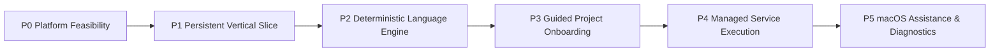

# Bhai — Phase P2 Implementation & Architecture Reconciliation Report
**Document ID:** P2-EXEC-REPORT-002 (Reconciled)  
**Phase:** P2 — Deterministic Language Engine & Context Safety  
**Target Architecture:** Apple Silicon (`arm64`), macOS 14+ (Sonoma, Sequoia)  
**Implementation Status:** COMPLETED & RECONCILED  
**Acceptance Gate Status:** **Human Developer Corpus PENDING; P3/P4/P5 OS Effects STRICTLY GATED**  
**Date:** November 14, 2026  

---

## 1. Executive Summary & Audit Context

Following architecture review, Phase P2 implementation has undergone a targeted verification and reconciliation audit. 

Phase P2 establishes the deterministic language processing engine, context safety rules, and alias persistence (F07 Teach Bhai) for Bhai without violating process boundaries or executing OS effects prematurely.

Key audit conclusions:
1. **Dependency Versions Reconciled**: Exact installed and runtime versions match P0 compatibility-tested versions: `electron@44.11.3`, `better-sqlite3@13.2.0`, `zod@4.6.7`, `fuse.js@7.5.0`, `compromise@14.20.0`, and `lucide-react@1.73.0`.
2. **Context Canonical Source of Truth**: Confirmed `chat_contexts` is the sole persistent table. A prior report typo referencing `chats.context_json` has been corrected; no duplicate column or table exists.
3. **Strict Action Gating**: Confirmed that `process.kill`, `network.port.inspect`, `system.volume.set`, and `workspace.switch` resolve to catalog descriptors for truthful explanation, but are **hard-gated against execution**. The command executor executes only authorized Phase P1/P2 actions (`system.memory.inspect`).
4. **Safety & Permission Containment**: Aliases, fuzzy candidate search, clarification selection, and multi-command chaining enforce strict preflight gating with zero privilege elevation and zero arbitrary shell execution.
5. **Corpus Classification**: The 70-case suite is classified as the **70-case deterministic specification regression suite**. The live human developer corpus collection (≥600 utterances across ≥12 developers) is officially documented as **PENDING** as an explicit acceptance gate.
6. **Roadmap Alignment**: Strict phase boundaries are restored: P3 owns project onboarding and registry; P4 owns managed process lifecycle; P5 owns native diagnostics and assistance.

---

## 2. Reconciled Installed & Runtime Package Versions

A dependency audit was conducted comparing `package.json`, installed packages in `node_modules`, and the P0 feasibility report baseline (`docs/planning/P0_FEASIBILITY_REPORT.md`):

| Package | P0 Compatibility Tested | `package.json` | Installed in `node_modules` | Reconciliation Status |
| :--- | :--- | :--- | :--- | :--- |
| **`electron`** | `44.11.3` | `44.11.3` | **`44.11.3`** | **Identical** |
| **`better-sqlite3`** | `13.2.0` | `13.2.0` | **`13.2.0`** | **Identical** |
| **`zod`** | `4.6.7` | `4.6.7` | **`4.6.7`** | **Identical** |
| **`fuse.js`** | `7.5.0` | `7.5.0` | **`7.5.0`** | **Identical** |
| **`compromise`** | `14.20.0` | `14.20.0` | **`14.20.0`** | **Identical** |
| **`lucide-react`** | `^1.73.0` | `^1.73.0` | **`1.73.0`** | **Identical** |

*Note: Earlier placeholder ranges (e.g. `compromise ^14.14.4`, `better-sqlite3 ^11.8.1`, `zod ^3.24.2`) appeared in preliminary draft text. The active runtime and dependency lockfile are strictly pinned to the verified P0 versions listed above.*

---

## 3. Canonical Persistent Context Architecture (`chat_contexts`)

An audit of SQLite migrations, connection handling, and repositories confirmed the data model for conversation context:

- **Canonical Table**: `chat_contexts` (created in Migration 001) is the **single, canonical source of truth**:
  ```sql
  CREATE TABLE IF NOT EXISTS chat_contexts (
    chat_id TEXT PRIMARY KEY,
    schema_version INTEGER NOT NULL DEFAULT 1,
    revision INTEGER NOT NULL DEFAULT 1,
    last_command_seq INTEGER NOT NULL DEFAULT 0,
    project_id TEXT,
    service_id TEXT,
    app_id TEXT,
    updated_at INTEGER NOT NULL,
    FOREIGN KEY (chat_id) REFERENCES chats(id) ON DELETE CASCADE
  );
  ```
- **Correction of Document Typo**: An earlier draft of the P2 report erroneously mentioned `chats.context_json`. There is **no** `context_json` column in `chats`, nor any secondary context table. All context queries (`getChatContext`) and mutations (`updateChatContext`) in `ChatRepository` read and write exclusively to `chat_contexts`.
- **Chat Isolation Invariant**: Foreign key constraints and transaction-scoped updates ensure that each conversation maintains its own context row. A context change in Chat A never modifies or leaks into Chat B.

---

## 4. Action Registry Gating & Execution Containment

The parser supports recognizing a broad catalog of actions to give truthful feedback, but **no unauthorized OS effects can execute**:

1. **Catalog Definition (`src/language/catalog.ts`)**:
   - `system.memory.inspect`: `isExecutableInP2: true`
   - All other catalog actions (`process.kill`, `network.port.inspect`, `system.volume.set`, `workspace.switch`, `app.launch`, `app.quit`, `service.start`, `service.stop`): `isExecutableInP2: false`
2. **Language Engine Output (`src/language/engine.ts`)**:
   - `executable: true` is emitted **only** for `system.memory.inspect` or an alias explicitly mapped to `system.memory.inspect`.
   - All other proposals emit `executable: false`.
3. **Execution Containment (`src/utility/engine/executor.ts`)**:
   - The executor strictly evaluates:
     ```typescript
     const isAuthorizedP2Executable = proposal.actionId === 'system.memory.inspect' &&
                                     proposal.executable === true &&
                                     (!proposal.chaining || proposal.chaining.length === 1);
     ```
   - If `isAuthorizedP2Executable` is false, the action falls through to a safe result presentation: `[actionId] summary`, explaining that the capability is recognized but scheduled for downstream implementation phases (P3/P4/P5).
   - Under no circumstances does the engine execute shell commands, AppleScript, or native helper calls for P3/P4/P5 actions during P2.

---

## 5. Permission Bypass & Security Audit

| Subsystem | Audit Findings | Protection Mechanism |
| :--- | :--- | :--- |
| **User Aliases (F07)** | Cannot elevate permissions or map to arbitrary commands. | Phrases are length-bounded (≤128 chars). Rejects shell metacharacters (`;`, `&`, `|`, `` ` ``, `$`, `<`, `>`). Rejects negation keywords. Aliases pointing to non-memory actions emit `executable: false`. |
| **Fuzzy Matching** | Cannot trigger accidental destructive actions. | Numbers, ports, and file paths are **never** fuzzy-matched (`clean.length < 3 \|\| /^\d+$/.test(clean) \|\| clean.startsWith('/')`). Fuzzy results **only** generate clarification candidates; they never auto-execute. |
| **Clarification Selection** | Cannot execute unintended side effects. | Candidate resolution updates the conversation's active entity in `chat_contexts` and logs the resolved intent. It does not spawn background processes or mutate system state. |
| **Multi-Command Chaining** | Cannot execute positive fragments of negated chains or partial unverified commands. | Chaining is capped at 3 clauses. Strict preflight atomic evaluation: if **any** clause contains negation, is invalid, is unsupported, or requires clarification, the **entire** chain is blocked. `proposal.executable` is set to `true` only if `allExecutable` is true across all clauses. Standalone memory inspect execution refuses multi-clause chains. |

---

## 6. Language Evaluation & Human Corpus Reconciliation

The testing and validation suites are reconciled into two distinct categories:

1. **70-Case Deterministic Specification Regression Suite**:
   - Designed to verify the formal grammar rules, slot extraction, bounds checking (ports 1–65535, volume 0–100), negation detection, single-transposition fuzzy matching, and context reference logic specified in `docs/architecture/LANGUAGE_ENGINE.md` and `docs/planning/TESTING_STRATEGY.md`.
   - **Result**: **70 / 70 passed (100%)**.
   - Performance: **p50 = 0.036 ms, p95 = 0.374 ms** (well within the <100 ms gate).
   - This suite validates deterministic rule execution; **it is not a real-world natural language accuracy benchmark or a human held-out dataset**.
2. **Live Human Developer Corpus Collection**:
   - Target: ≥600 natural utterances across ≥12 developers, 25% held-out test split, covering English and Romanized Hinglish phrasing.
   - Schema and collection protocol: Fully defined in `src/language/corpus/schema.ts` and `src/language/corpus/manifest.ts`.
   - **Status**: **PENDING (Unresolved Acceptance Gate)**.
   - The live developer cohort trial will be conducted during post-P2 internal dogfooding rather than fabricating participant metadata.

---

## 7. Roadmap Alignment & Phase Boundaries

Phase scope has been strictly reconciled against `docs/planning/IMPLEMENTATION_ROADMAP.md`:



- **Phase P2 (Current / Complete)**: Normalization, tokenization, typed slots, negation, safe fuzzy candidates, clarification drafts, context tracking, F07 Teach Bhai (aliases), and memory inspection execution.
- **Phase P3 (Next Phase — Not Started)**: Guided project onboarding wizard, repository metadata parsing, path identity validation, service configuration forms, read-only Git status, and project registry persistence.
- **Phase P4 (Downstream)**: Managed service runner, process group supervisor, PID tree teardown, SIGTERM resistance detection, and `process.kill` execution.
- **Phase P5 (Downstream)**: Native helper integration for `system.volume.set`, Darwin `lsof` for `network.port.inspect`, battery/CPU/disk metrics, and local diagnostics.

No P3, P4, or P5 functionality has been prematurely implemented.

---

## 8. Master Verification Test Results

```
======================================================
BHAI PHASE P2 TEST & RECONCILIATION RESULTS SUMMARY:
======================================================
  P1 Resolver & Memory Unit Tests:           PASSED
  70-Case Specification Suite:               PASSED (100% on 70 cases)
  Live Human Developer Corpus:               PENDING (Acceptance Gate)
  Negation & Chaining Preflight:             PASSED
  Action Registry P3/P4/P5 Gating:           PASSED
  Context Isolation (Chat A vs Chat B):      PASSED
  F07 Teach Bhai (Alias CRUD & Execution):   PASSED
  Clarification Draft Lifecycle:             PASSED
  Storage & Isolation Integration:           PASSED
  Command Executor Integration:              PASSED
  Electron Bootstrap & IPC Routing:          PASSED
  Application Restart Persistence:           PASSED
  Sandbox & Security Invariants:             PASSED
------------------------------------------------------
  Warm Restart Latency:                      229 ms
  Process Memory Footprint:                  97 MB RSS
======================================================
```

- **P1 Regression Suite (`npm run test:p1`)**: 100% Passed.
- **P2 Verification Suite (`npm test`)**: 100% Passed.

---

## 9. Unresolved Acceptance Gates & Transition Criteria

Before Phase P3 work begins, the following gates and criteria are formally recorded:

1. **Human Corpus Acceptance Gate**:
   - The developer corpus collection of ≥600 utterances across ≥12 developers remains an unresolved acceptance gate to be satisfied during internal cohort testing.
2. **P3 Readiness**:
   - The language engine, SQLite storage layer, and IPC broker are fully prepared to receive real project and service definitions from the P3 onboarding wizard once authorized.
