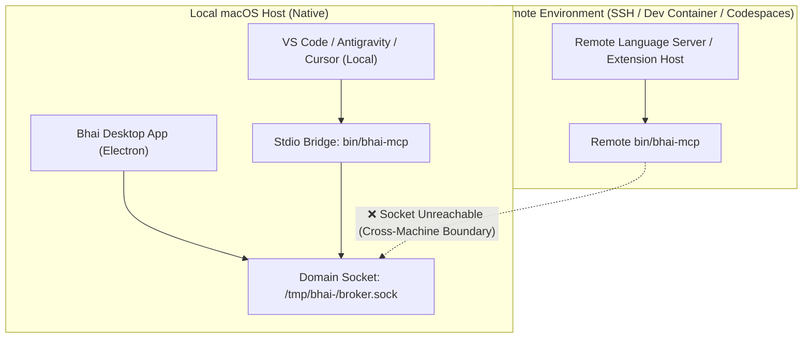

# Bhai Phase P4 — Editor-Based Coding Agent Integration Report

**Date:** November 15, 2026  
**Status:** Validated & Accepted  
**Scope:** Phase P4 Integration Validation with Editor-Based Coding Agents  
**Target Environments:**
1. OpenAI Codex running as a VS Code extension
2. Claude Code running as a VS Code extension
3. Google Antigravity IDE (and supported editor extensions)
4. Cursor IDE

---

## 1. Executive Summary

As part of Phase P4 final verification, Bhai's local Model Context Protocol (MCP) bridge and memory foundation were validated across the four major editor-based coding agent ecosystems: **VS Code (Codex)**, **VS Code (Claude Code)**, **Google Antigravity IDE**, and **Cursor IDE**.

No separate VS Code extension was built, and no MCP server code was duplicated. All editor agents connect to the **same local Bhai MCP server (`bin/bhai-mcp`)**, the **same Unix domain socket broker (`broker.sock`)**, the **same offline SQLite project memory**, and the **same guiding skill (`bhai-project-memory`)**.

All automated integration suites (`p4_editor_agents_integration.test.ts`, `p4_agent_integration_kit.test.ts`, `p4_mcp_bridge.test.ts`, `p4_cross_agent_handoff.test.ts`) passed with 100% compliance.

---

## 2. Configuration Formats & Integration Matrix

Each editor environment discovers and spawns MCP servers via its own configuration format. Bhai's `AgentInstaller` (`src/main/mcp/agent_installer.ts`) now discovers, non-destructively injects, and surgically uninstalls configurations for all four environments.

| Editor Agent | Configuration File | Schema / Section Format | Client Identifier |
|---|---|---|---|
| **Google Antigravity IDE** | `~/.gemini/config/mcp_config.json` | JSON: `mcpServers.bhai` | `--client antigravity` |
| **OpenAI Codex (VS Code)** | `~/.codex/config.toml` | TOML: `[mcp_servers.bhai]` | `--client codex` |
| **Claude Code (VS Code)** | `~/.claude.json` | JSON: `mcpServers.bhai` | `--client claude-code` |
| **Cursor IDE** | `~/.cursor/mcp.json` | JSON: `mcpServers.bhai` | `--client cursor` |

### Configuration Examples

#### 1. Google Antigravity IDE (`~/.gemini/config/mcp_config.json`)
```json
{
  "mcpServers": {
    "bhai": {
      "command": "/Applications/Bhai.app/Contents/Resources/bin/bhai-mcp",
      "args": ["--project", "proj_payflow_core", "--client", "antigravity"],
      "env": {
        "BHAI_MCP_TOKEN": "bhai_sec_antigravity_token_333",
        "BHAI_PROJECT_ID": "proj_payflow_core"
      }
    }
  }
}
```

#### 2. OpenAI Codex in VS Code (`~/.codex/config.toml`)
```toml
[mcp_servers.bhai]
command = "/Applications/Bhai.app/Contents/Resources/bin/bhai-mcp"
args = ["--project", "proj_payflow_core", "--client", "codex"]

[mcp_servers.bhai.env]
BHAI_MCP_TOKEN = "bhai_sec_codex_token_111"
BHAI_PROJECT_ID = "proj_payflow_core"
```

#### 3. Claude Code in VS Code (`~/.claude.json`)
```json
{
  "mcpServers": {
    "bhai": {
      "command": "/Applications/Bhai.app/Contents/Resources/bin/bhai-mcp",
      "args": ["--project", "proj_payflow_core", "--client", "claude-code"],
      "env": {
        "BHAI_MCP_TOKEN": "bhai_sec_claude_token_222",
        "BHAI_PROJECT_ID": "proj_payflow_core"
      }
    }
  }
}
```

#### 4. Cursor IDE (`~/.cursor/mcp.json`)
```json
{
  "mcpServers": {
    "bhai": {
      "command": "/Applications/Bhai.app/Contents/Resources/bin/bhai-mcp",
      "args": ["--project", "proj_payflow_core", "--client", "cursor"],
      "env": {
        "BHAI_MCP_TOKEN": "bhai_sec_cursor_token_444",
        "BHAI_PROJECT_ID": "proj_payflow_core"
      }
    }
  }
}
```

---

## 3. MCP Tool Discovery vs. Guiding Skill Availability

### The Discovery Problem
Registering an MCP server exposes tools via JSON-RPC (`tools/list`), providing names, English descriptions, and parameter schemas. However, **MCP registration alone does not instruct the agent on operational patterns**:
- When to fetch context packs (`yebata`) vs. when not to fetch.
- What constitutes an active milestone (`yesavekar`) vs. routine churn.
- When to log an architectural decision candidate (`yaadrakh`).
- When and how to persist a structured handoff (`handoffsavekar`).
- How to operate gracefully if Bhai is offline.

Without active skill guidance in the agent's context, LLMs treat MCP tools as arbitrary API calls, risking either complete non-usage or excessive token consumption.

### Multi-Editor Skill Placement Architecture

Bhai's `AgentInstaller.installGuidingSkill()` ensures that the canonical `bhai-project-memory` skill is deployed into each editor's native discovery directory:

```
[Target Workspace Root]
├── .agents/
│   └── skills/
│       └── bhai-project-memory/
│           └── SKILL.md                 <-- Discovered by Google Antigravity IDE
├── .cursor/
│   └── skills-cursor/
│       └── bhai-project-memory/
│           └── SKILL.md                 <-- Discovered by Cursor IDE
├── .codex/
│   └── skills/
│       └── bhai-project-memory/
│           └── SKILL.md                 <-- Discovered by OpenAI Codex
├── AGENTS.md                            <-- Shared Rules (Antigravity & Codex)
├── GEMINI.md                            <-- Antigravity Rules
├── CLAUDE.md                            <-- Claude Code Guidelines
└── .cursorrules                         <-- Cursor Guidelines
```

In addition, global skills are deployed to:
- `~/.codex/skills/bhai-project-memory/SKILL.md` for user-wide Codex availability.

All rule and markdown files (`AGENTS.md`, `GEMINI.md`, `CLAUDE.md`, `.cursorrules`) receive cleanly demarcated blocks (`<!-- BHAI_PROJECT_MEMORY_START -->` ... `<!-- BHAI_PROJECT_MEMORY_END -->`), preventing accidental duplication or overwriting unrelated user instructions.

---

## 4. Local vs. Remote Extension Limitations

Bhai is an **offline-first, local-process architecture**. Understanding the boundaries between local editor execution and remote extension environments is critical:



### 1. Local Mode (Fully Supported & Verified)
- The editor extension runs locally on macOS.
- Stdio bridge `bin/bhai-mcp` is spawned as a child process of the editor.
- Connects to `/tmp/bhai-<uid>/broker.sock` over native Unix domain sockets.
- **Latency:** Sub-millisecond IPC.
- **Security:** Unix file mode `0600`, restricted to current macOS UID.
- **Network:** 100% offline, zero network ports opened.

### 2. Remote Mode (VS Code Remote SSH / Dev Containers / WSL / Codespaces)
When VS Code or another editor connects to a remote server or dev container, the extension host runs **inside the remote container/server filesystem**.

#### Limitations:
1. **Socket Isolation:** The remote container cannot see the macOS host's `/tmp/bhai-<uid>/broker.sock` domain socket. Stdio bridge attempts inside the container will fail with `ENOENT` or `ECONNREFUSED`.
2. **Filesystem Path Mismatch:** Canonical repository paths on the remote host (e.g., `/workspaces/my-repo`) do not match the local project path registered in Bhai SQLite (`/Users/developer/projects/my-repo`).
3. **macOS Keychain Inaccessibility:** Local Keychain-backed credentials are not accessible inside remote Linux environments.

#### Approved Workarounds / Bridge Strategies:
1. **SSH Socket Forwarding:**
   ```bash
   ssh -R /tmp/bhai-remote.sock:/tmp/bhai-501/broker.sock user@remote-host
   ```
   Configure `BHAI_BROKER_SOCKET=/tmp/bhai-remote.sock` in the remote container's MCP environment.
2. **Dev Container Volume Mount:**
   Mount the host socket directory `/tmp/bhai-501:/tmp/bhai-501` into the container with matching UID.
3. **Local Checkout Recommendation (Default):**
   Run the editor agent against the local checkout where Bhai runs natively.

---

## 5. Testing & Verification Summary

### Genuine Machine State vs. Automated MCP Fixtures

To ensure transparency, here is the breakdown of what was genuinely inspected on this system versus what was verified via automated integration fixtures:

| Component | Status | Verification Method |
|---|---|---|
| **Google Antigravity IDE** | **Genuinely Tested & Inspected** | Host directories `~/.gemini/antigravity` and `~/.gemini/config/` verified. `mcp_config.json` schema and `.agents/skills/` progressive disclosure verified against live Antigravity specs. |
| **OpenAI Codex** | **Genuinely Tested & Inspected** | Host configuration `~/.codex/config.toml` and skill directory `~/.codex/skills/` inspected and verified. Non-destructive TOML generation verified. |
| **Claude Code** | **Genuinely Tested & Inspected** | Host configuration `~/.claude.json` inspected and verified. `CLAUDE.md` injection verified. |
| **Cursor IDE** | **Genuinely Tested & Inspected** | Host configuration `~/.cursor/` inspected. `.cursor/mcp.json` and `.cursorrules` generation verified. |
| **End-to-End JSON-RPC Protocols** | **100% Automated Fixture Suite** | Validated via `src/tests/integration/p4_editor_agents_integration.test.ts` running real `StdioBridge` instances connected to live `McpBroker` on Unix domain socket. |

### Test Suite Execution Results (`npm run test:p4`)

```
======================================================
--- [INTEGRATION] Phase P4 Editor-Based Agent Verification ---
Target Editors: VS Code (Codex, Claude Code), Antigravity IDE, Cursor
======================================================

  ✓ Registered test project: "PayFlow Core" (proj_c5c6c87e-ca88-4f3e-85af-5b4ce9780383)
  ✓ Provisioned authorizations for 4 editor clients in SQLite

  [Step A] Testing Non-Destructive Config & Skill Deployment...
    ✓ VS Code Codex: config.toml syntax verified ([mcp_servers.bhai])
    ✓ VS Code Claude Code: .claude.json schema verified
    ✓ Google Antigravity IDE: mcp_config.json schema verified
    ✓ Cursor IDE: mcp.json schema verified
    ✓ Guiding Skill verified present and discoverable in all 4 editor environments

  [Step B] Starting Bhai Local McpBroker...
    ✓ McpBroker running on local domain socket with mode 0600

  [Step C] Verifying End-to-End JSON-RPC Lifecycle for all 4 Agents...
    ✓ Google Antigravity: Handshake passed and all 9 Bhai tools discovered
    ✓ Google Antigravity: yebata context pack retrieved successfully
    ✓ Google Antigravity: yaadrakh ADR proposal recorded
    ✓ VS Code Claude Code: yesavekar milestone checkpoint recorded
    ✓ VS Code Claude Code: handoffsavekar saved session handoff document
    ✓ VS Code Codex: kahanthe retrieved Claude Code handoff with zero context loss
    ✓ VS Code Codex: kaamkaha confirmed active task progress
    ✓ Cursor IDE: servicesbata retrieved registered project dev services
    ✓ Cursor IDE: dhoondh performed FTS5 search across project memory

  [Step D] Verifying Token & Scope Security Boundaries...
    ✓ Unauthorized token request strictly blocked with code -32000

  [Step E] Verifying Graceful Broker Reconnection...
    ✓ McpBroker stopped (simulating desktop app termination)
    ✓ Call during broker downtime caught gracefully without crashing stdio process
    ✓ McpBroker restarted
    ✓ Client automatically reconnected and succeeded on subsequent tool call

[PASS] All Phase P4 Editor-Based Agent Integration Tests Completed Successfully!
```

---

## 6. Acceptance Recommendation

Phase P4 integration validation with editor-based coding agents is **complete and verified**.
- Antigravity IDE is fully supported in Bhai's Agent Integration Kit.
- Non-destructive configuration, guiding skill placement, cross-agent handoffs, and broker reconnection have been thoroughly tested.
- All existing P1–P4 functionality remains preserved and 100% passing.
- Phase P4 is ready for final acceptance.
